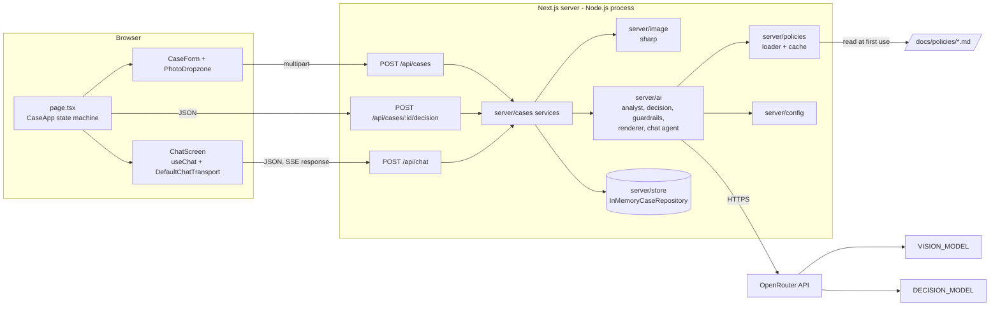
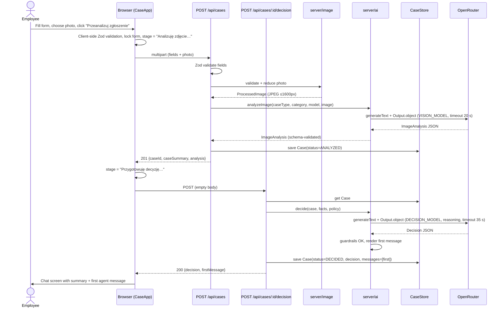
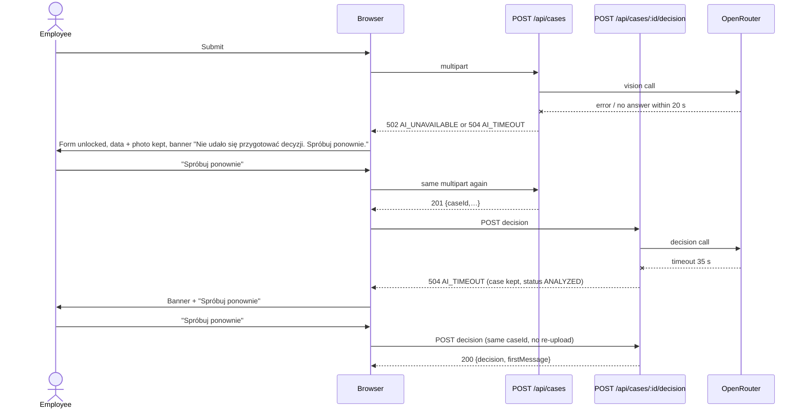
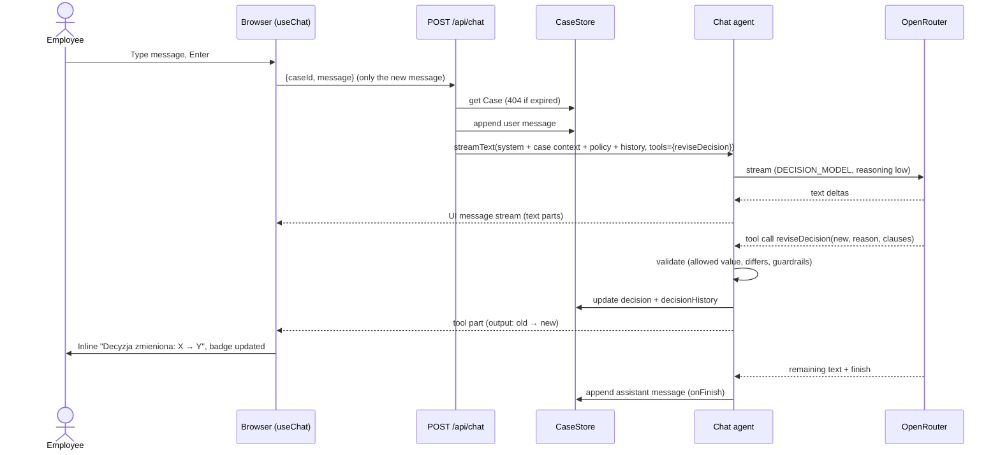
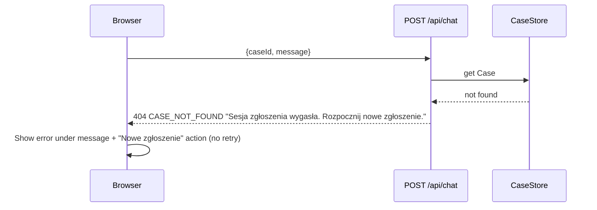

# ADR: Hardware Service Decision Copilot — Main Architecture

**Date:** 2026-11-25
**Status:** Accepted
**PRD:** [`docs/PRD.md`](../PRD.md)

---

## 1. Overview

The Hardware Service Decision Copilot PoC is an internal web tool. A support employee submits a
return or complaint case (form + one photo). The system:

1. reduces the photo,
2. has a multimodal model describe it,
3. has a reasoning model decide against the matching policy document,
4. opens a chat whose first message is the decision and whose later turns stream from the agent.

This ADR set turns the PRD into implementable technical decisions. The PRD owns functional
behavior and acceptance criteria (`AC-xx`). These ADRs own stack, structure, contracts, data
shapes and tests (`TAC-xx`).

| ADR | Area |
|---|---|
| `000-main-architecture.md` (this) | Stack, repository layout, module map, cross-cutting decisions, end-to-end diagrams, overall testing strategy |
| [`001-backend-api.md`](001-backend-api.md) | Route handlers, validation, image processing, case store, error model |
| [`002-ai-pipeline.md`](002-ai-pipeline.md) | Models, prompts, structured outputs, policy injection, guardrails, chat agent and decision revision |
| [`003-frontend.md`](003-frontend.md) | Screens, client state machine, components, chat client, styling with design tokens |
| [`004-confidence-gated-decisions.md`](004-confidence-gated-decisions.md) | Preliminary decisions with GPT-6 Luna Decisions, per-question confidence threshold, routing (`RULES` / `FAST` / `LLM` / `LLM_ESCALATED`), shadow mode and threshold eval. Amends 002 where they differ |

Phase 2 items (PRD 12.1: customer data, case history, RAG) are **not** implemented in v1. The
architecture leaves seams for them: the repository interface (Decision 8.3) and the AI context
builder (002 §3.1, `context.ts`).

---

## 2. Technology Documentation References

Context7 IDs were resolved and the key APIs verified with Context7 MCP on 2026-11-25.
Implementing agents call `query-docs` with these IDs directly. IDs are templates without a
pinned dependency version: append the version that matches the installed package in
`app/package-lock.json`, in the form `/<org>/<project>/vxx.x.x` (e.g. `/vercel/next.js/vxx.x.x`),
when Context7 lists it; otherwise use the bare ID.

| Library | Version (npm, 2026-11-25) | Context7 ID | Official docs | Used for |
|---|---|---|---|---|
| Next.js (App Router) | 16.4.x | `/vercel/next.js` | https://nextjs.org/docs/app | Full-stack framework, route handlers, page |
| React | as required by Next 16 | — (not needed for decisions) | https://react.dev | UI |
| Vercel AI SDK (`ai`) + `@ai-sdk/react` | 7.0.x | `/websites/ai-sdk_dev` | https://ai-sdk.dev/docs | `generateText` + `Output.object`, `streamText`, `toUIMessageStream`, `useChat`, `DefaultChatTransport`, `ai/test` mocks |
| AI SDK Cookbook | — | `/websites/ai-sdk_dev_cookbook` | https://ai-sdk.dev/cookbook | Recipes (e.g. sending only the last chat message) |
| OpenRouter AI SDK provider (`@openrouter/ai-sdk-provider`) | 3.1.x | `/openrouterteam/ai-sdk-provider` | https://github.com/OpenRouterTeam/ai-sdk-provider | Model access through OpenRouter, `providerOptions.openrouter` |
| OpenRouter platform | — | `/websites/openrouter_ai` | https://openrouter.ai/docs/guides/best-practices/reasoning-tokens | Model slugs, reasoning tokens |
| Zod | 4.x | `/colinhacks/zod` | https://zod.dev | Shared input schemas and LLM output schemas |
| sharp | 0.35.x | `/lovell/sharp` | https://sharp.pixelplumbing.com | Image validation, orientation, resizing, re-encoding |
| Tailwind CSS | 4.x | `/tailwindlabs/tailwindcss.com` | https://tailwindcss.com/docs/theme | Styling with `@theme` tokens |
| react-markdown | 10.x | `/remarkjs/react-markdown` | https://github.com/remarkjs/react-markdown | Rendering agent Markdown safely |
| Vitest | 5.x | `/vitest-dev/vitest` | https://vitest.dev · https://nextjs.org/docs/app/guides/testing/vitest | Unit and integration tests |
| Testing Library (React) | 16.x | — (not resolved) | https://testing-library.com/docs/react-testing-library/intro | Component tests |
| Playwright Test | 1.65.x | `/microsoft/playwright` | https://playwright.dev/docs/intro | E2E tests on the real stack |

Compatibility notes:
- The OpenRouter provider README states that its current line targets `ai@^7` on Node 22+, ESM
  only. The VM runs Node 24.
- Pin exact versions in `package-lock.json` at scaffold time.

---

## 3. System Architecture

### Architecture pattern
A **modular monolith**: one Next.js 16 App Router project. It contains:
- the single-page client UI,
- server-side route handlers (the backend API),
- server-only modules for image processing, AI orchestration, policies and the in-memory case
  store.

It runs as one Node.js process. There are no separate services, queues or databases in v1.

### Repository structure
The Next.js project lives in `app/`; `package.json` is in `app/`. All commands run from `app/`.

```
app/
  package.json, package-lock.json, next.config.ts, tsconfig.json, vitest.config.mts,
  playwright.config.ts, postcss.config.mjs, eslint.config.mjs, .prettierrc, .env.example
  AGENTS.md                      stack-specific rules for agents (created at scaffold)
  CLAUDE.md                      contains only `@AGENTS.md`: Claude Code does not auto-load a
                                 nested AGENTS.md (amendment A6); OpenCode and Codex read it directly
  public/                        logo, favicon, fonts copied from ../assets at scaffold time
  src/
    app/                         Next.js routes only (thin)
      layout.tsx, page.tsx, globals.css
      api/cases/route.ts                         POST create case + image analysis
      api/cases/[caseId]/decision/route.ts       POST generate decision
      api/chat/route.ts                          POST streamed chat turn
    components/                  client UI components (003)
    lib/shared/                  isomorphic: Zod input schemas, enums, Polish labels, date utils
    server/                      server-only (never imported by client components)
      config/                    env parsing and validation
      http/                      request parsing, error responses
      image/                     validation + reduction (sharp)
      store/                     CaseRepository interface + in-memory implementation
      policies/                  policy loader (reads ../docs/policies)
      ai/                        model registry, prompts/, schemas, analyst, decision, chat, guardrails
      cases/                     use-case services orchestrating the above
  tests/
    fixtures/llm-captures/       verbatim captured model responses + metadata
    fixtures/images -> uses ../assets/example-images directly (no copies)
  e2e/                           Playwright specs (real stack)
  evals/                         opt-in real-model evaluation runner
```

The policy documents stay in `docs/policies/` as the single source of truth (PRD §8 table). The
server reads them from a configurable directory (Decision 8.6).

### Technology stack

| Layer | Technology | Reason |
|---|---|---|
| Runtime | Node.js 24 (installed on VM) | Satisfies OpenRouter provider (Node 22+) and sharp |
| Framework | Next.js 16 App Router, TypeScript strict | One project for UI and API; route handlers default to the Node.js runtime needed by sharp |
| Package manager | npm | Preinstalled; no extra setup on course VMs |
| Frontend | React (Next 16) client components | Single interactive page with form → chat state machine |
| Styling | Tailwind CSS v4 with `@theme` tokens from `assets/design-tokens.json` | Token-driven styling without a component library |
| Backend API | Next.js route handlers | Multipart upload, JSON and streaming responses in the same process |
| Validation | Zod 4 (shared client/server schemas) | One definition of form rules; also used for LLM structured outputs |
| Image processing | sharp | Content-based format detection, EXIF auto-orient, resize, re-encode, metadata stripping |
| AI orchestration | Vercel AI SDK 7 | Structured output with schema validation, streaming chat, tools, timeouts, retries |
| AI provider | OpenRouter via `@openrouter/ai-sdk-provider` | One key (`OPENROUTER_API_KEY` already in `.env.example`); models switchable via env |
| Preliminary decisions | `openai/gpt-6-luna-decisions` via OpenRouter Decisions API (`POST /api/alpha/decisions`, plain `fetch`) | Typed answers with calibrated probabilities in ~0.2 s; confidence-gated fast path (004) |
| State (v1) | In-memory case store behind a repository interface | PRD AC-36: no persistence in v1; seam for SQLite in Phase 2 |
| Markdown rendering | react-markdown without raw HTML | Safe rendering of agent output (PRD AC-26) |
| Tests | Vitest + Testing Library, Playwright, custom eval runner | TDD per `AGENTS.md`; E2E on real stack; quality checks on real model |
| Deployment | Local only: `npm run dev` / `npm run build && npm run start` on port 3000 | PoC on course VM; no Docker or cloud |

---

## 4. Module Structure & Dependencies

| Module | Responsibility | Depends on | Used by |
|---|---|---|---|
| `lib/shared` | Form input schema, enums (`CaseType`, `DeviceCategory`, decision enums), Polish labels, limits constants, date helpers (Europe/Warsaw "today", days between dates) | Zod | `components`, `server/*`, route handlers |
| `server/config` | Read and validate env vars once at startup; fail fast with a clear message | Zod | `server/ai`, `server/policies`, `server/store` |
| `server/http` | Parse multipart/JSON, map domain errors to HTTP error responses (001 §5) | `lib/shared` | route handlers |
| `server/image` | Detect real format from bytes, enforce limits, auto-orient, resize, re-encode, strip metadata | sharp, `lib/shared` | `server/cases` |
| `server/policies` | Load return/complaint policy Markdown, compute version hash, cache in memory | `server/config` | `server/ai` |
| `server/store` | `CaseRepository` interface; `InMemoryCaseRepository` with TTL + capacity eviction | `server/config` | `server/cases`, chat route |
| `server/ai` | Model registry, prompt templates, output schemas, image analyst, decision agent, guardrails, first-message renderer, chat agent + `reviseDecision` tool | AI SDK, OpenRouter provider, `server/policies`, `lib/shared` | `server/cases`, chat route |
| `server/decisions` | Decision routing (`DECISION_MODE`), Luna Decisions client, question sets, certainty, fast-path mapping ([004](004-confidence-gated-decisions.md)) | `server/config`, `server/ai` (guardrails, schemas), `lib/shared` | `server/cases` |
| `server/cases` | Use-case services: `createCaseWithAnalysis`, `decideCase`, `appendChatTurn` | `server/image`, `server/ai`, `server/store` | route handlers |
| `app/api/*` | Thin HTTP adapters: parse → call service → serialize | `server/http`, `server/cases` | client |
| `components` | UI (003) | `lib/shared`, `@ai-sdk/react`, react-markdown | `app/page.tsx` |

Dependency direction:
- `app/api` → `server/cases` → (`server/ai`, `server/image`, `server/store`) → (`server/policies`,
  `server/config`) → `lib/shared`.
- `components` → `lib/shared`.
- Rules:
  - `components` and `lib/shared` never import from `server/`. Enforce this with the
    `server-only` marker package in every `server/` entry module.
  - No circular dependencies.
  - An ESLint `no-restricted-imports` rule forbids importing `@/server/**` from `src/components/**`
    and `src/lib/**` (TAC-04). The rule covers all of `src/server/**`, including `server/decisions`.

---

## 5. Data Models

All models are conceptual. Exact Zod shapes are specified in 001 §4 and 002 §4.

| Model | Purpose | Key fields | Persistence |
|---|---|---|---|
| `CaseInput` | Validated form data | `caseType` (`RETURN`\|`COMPLAINT`), `category` (9-value enum, PRD AC-03), `model` (string 2–100), `purchaseDate` (ISO date `YYYY-MM-DD`), `reason` (string ≤2000, ≥10 if complaint) | Inside `Case` |
| `ProcessedImage` | Reduced photo used only for the analysis call | `bytes`, `format` (`jpeg`), `width`, `height`, `byteSize`, `originalFormat`, `originalByteSize` | **Not stored** — discarded after analysis (privacy, Decision 8.5) |
| `ImageAnalysis` | Structured description from the multimodal model | See 002 §4.1 | Inside `Case` |
| `DecisionFacts` | Deterministic facts computed by code | `submissionDate`, `daysSincePurchase`, `windowDays` (14 / 730), `withinWindow`, `isDeadOnArrivalWindow` (complaint ≤14 days) | Inside `Case` |
| `Decision` | Structured decision | `value` (enum per case type), `citedClauses[]`, `justification[]`, `nextSteps[]`, `missingEvidence[]`, `confidence`, `source` (`MODEL`\|`GUARDRAIL`\|`CHAT_REVISION`) | Inside `Case`; history kept in `decisionHistory[]` |
| `ChatMessage` | One message in AI SDK UI-message format (id, role, parts) | `id`, `role`, `parts[]` (text, tool parts), `createdAt` | Inside `Case.messages[]` |
| `Case` | Aggregate for one session | `id` (UUID v4), `status` (`ANALYZED`\|`DECIDED`), `input`, `imageMeta` (no bytes), `analysis`, `facts`, `decision`, `decisionHistory[]`, `messages[]`, `policyVersion`, `promptVersions`, `createdAt`, `lastAccessAt` | In-memory, TTL 2 h since last access, max 200 cases (oldest-access eviction) |

Relationships: one `Case` has one `CaseInput`, one `ImageAnalysis`, one current `Decision`
(plus history) and many `ChatMessage`s. There are no cross-case relationships in v1.

---

## 6. API / Interface Contracts

Summary only; full contracts in [001 §5](001-backend-api.md#5-interface-contracts).

| Endpoint | Input | Output | Notes |
|---|---|---|---|
| `POST /api/cases` | `multipart/form-data`: `caseType`, `category`, `model`, `purchaseDate`, `reason`, `photo` | `201` JSON: `caseId`, `caseSummary`, `analysis` | Validates, reduces image, runs image analysis. Stage 1 of loading UI |
| `POST /api/cases/{caseId}/decision` | none (body empty) | `200` JSON: `decision`, `firstMessage` (UI message) | Idempotent: returns existing decision if already decided. Stage 2 of loading UI |
| `POST /api/chat` | JSON: `caseId`, `message` (the new user UI message only) | UI message stream (SSE) | Server holds history; client never sends prior messages |

Error body for all JSON errors: `{ error: { code, message, fieldErrors? } }`. `message` is in
Polish and ready to display. Codes are listed in 001 §5.

No authentication (PRD Out of Scope). No CORS: same-origin only.

---

## 7. Environment Variables

| Variable | Purpose | Required | Example value |
|---|---|---|---|
| `OPENROUTER_API_KEY` | OpenRouter API key, server-side only | Yes | `sk-or-v1-…` |
| `VISION_MODEL` | OpenRouter model slug for image analysis (must support image input + structured output) | Yes | `anthropic/claude-sonnet-5.5` |
| `DECISION_MODEL` | OpenRouter model slug for decision + chat (reasoning-capable, tool calling) | Yes | `anthropic/claude-opus-5.5` |
| `DECISION_REASONING_EFFORT` | OpenRouter `reasoning.effort` for the decision call | No (default `medium`) | `medium` |
| `CHAT_REASONING_EFFORT` | `reasoning.effort` for chat turns | No (default `low`) | `low` |
| `POLICY_DIR` | Directory with `return-policy.md` and `complaint-policy.md` | No (default `../docs/policies`, resolved from `process.cwd()` = `app/`) | `../docs/policies` |
| `CASE_TTL_MINUTES` | Idle lifetime of a case in memory | No (default `120`) | `120` |
| `CASE_STORE_MAX` | Max cases kept in memory | No (default `200`) | `200` |
| `APP_TIMEZONE` | Timezone for "today" and day counts | No (default `Europe/Warsaw`) | `Europe/Warsaw` |
| `DECISION_MODE`, `LUNA_MODEL`, `LUNA_CONFIDENCE_THRESHOLD`, `LUNA_TIMEOUT_MS` | Confidence-gated decisions; see [004 §9](004-confidence-gated-decisions.md#9-environment-variables-additions-to-000-7) | No (defaults `shadow`, `openai/gpt-6-luna-decisions`, `0.80`, `5000`) | `shadow` |

Notes:
- Model slug examples must be verified on https://openrouter.ai/models at scaffold time.
- The root `.env.example` still has `LLM_MODEL`. At scaffold time, replace it with the variables
  above in `app/.env.example` and remove `LLM_MODEL` from the root file. Keep a pointer in the
  root `README.md` if needed.
- No variable is exposed with the `NEXT_PUBLIC_` prefix (PRD AC-38).

---

## 8. Technical Decisions

### 8.1 Next.js full-stack monolith
**Status:** Accepted
**Date:** 2026-11-25
**Context:** The PoC needs a form with upload, a server-side AI pipeline that must keep the API
key secret, and a streaming chat. The course time is limited and agents must scaffold quickly.
**Decision:** One Next.js 16 App Router project in `app/`. Route handlers provide the API in the
same process as the UI, and the AI SDK integrates with both sides.
**Rejected alternatives:**
- FastAPI + React (Vite): two toolchains, two dev servers and duplicated validation schemas;
  slower to scaffold.
- FastAPI + Jinja/HTMX: streaming chat and client-side photo preview become custom work.
**Consequences:**
- (+) Shared TypeScript types and Zod schemas between client and server.
- (+) One `npm run dev`.
- (-) The team's Python/SQL experience is used less.
- (-) The in-memory store is tied to one long-running Node process. That is fine locally, but
  incompatible with serverless hosting.
**Review trigger:** Deployment to a serverless platform, or a requirement for a Python-only ML
component.

### 8.2 Two-step submission (analysis, then decision) instead of one request
**Status:** Accepted
**Date:** 2026-11-25
**Context:** PRD §9.2 requires real loading stages ("Analizuję zdjęcie…" → "Przygotowuję
decyzję…"). AC-33 requires retry without re-entering data. A single long request cannot report
progress without a custom streaming protocol.
**Decision:** `POST /api/cases` uploads the photo and runs image analysis. `POST
/api/cases/{id}/decision` runs the decision. The client switches the loading stage between the two
calls. On a decision failure, **Spróbuj ponownie** retries only the decision step if the case still
exists. On an analysis failure it re-submits the form.
**Rejected alternatives:**
- One request with NDJSON progress events: more protocol code and harder to test.
- One request with a client-side timed fake stage switch: misrepresents progress.
**Consequences:**
- (+) Honest progress.
- (+) A cheap retry of the expensive reasoning step.
- (+) Each step is testable in isolation.
- (-) Two round trips.
- (-) The case exists in memory before it is decided (status `ANALYZED`).
**Review trigger:** If total latency becomes dominated by round trips, or if more pipeline stages
are added (Phase 2 lookup), consider a single streamed progress endpoint.

### 8.3 Server-held case state in memory, keyed by `caseId`
**Status:** Accepted
**Date:** 2026-11-25
**Context:** The chat agent needs the full context: form data, image analysis, decision and
history. If the client sent that context, it could alter the decision or the analysis it is based
on.
**Decision:** The server stores the `Case` aggregate in an `InMemoryCaseRepository`, behind a
`CaseRepository` interface. The client sends only `caseId` and the new message. Entries expire 2 h
after last access, with at most 200 entries and least-recently-accessed eviction. The repository
instance is held on a `globalThis` singleton so that dev-mode hot reload does not drop it.
**Rejected alternatives:**
- Client holds full history (stateless server): context can be tampered with, and payloads grow.
- SQLite now: that is Phase 2 scope (P2-B). The interface makes it a drop-in later.
**Consequences:**
- (+) A tamper-resistant context.
- (+) Small chat requests.
- (+) A clear Phase 2 seam.
- (-) A server restart loses all cases, which is acceptable per PRD AC-36.
- (-) The store is single-process only.
**Review trigger:** Phase 2 P2-B (persistence), more than one server instance, or a requirement
that a case survive a restart.

### 8.4 OpenRouter with two configurable models
**Status:** Accepted
**Date:** 2026-11-25
**Context:** The PRD requires a multimodal model for images and a "thinking" model for decisions.
The repository already standardises on `OPENROUTER_API_KEY`.
**Decision:** Access all models through OpenRouter using the AI SDK OpenRouter provider:
- `VISION_MODEL` handles image analysis.
- `DECISION_MODEL` handles both decision and chat, with reasoning enabled through OpenRouter's
  `reasoning.effort`. The default effort is `medium` for decisions and `low` for chat.
- Defaults are Claude models; any model with image input, structured output and tool support can
  be swapped in via env.
**Rejected alternatives:**
- Direct Anthropic API: needs a different key than the course standard and locks the PoC to one
  vendor.
- A single model for both steps: less control over cost and latency per step.
**Consequences:**
- (+) Models can be swapped without code changes.
- (+) One key.
- (-) One more intermediary: OpenRouter availability and its rate limits apply.
- (-) Reasoning parameters are passed through by the provider. Their exact effect is
  model-specific and must be verified with a capture (002 §6).
**Review trigger:** OpenRouter outage or limits affect the demo, a model lacks required
capabilities, or production data-processing requirements rule out an intermediary.

### 8.5 The photo is reduced server-side and never stored
**Status:** Accepted
**Date:** 2026-11-25
**Context:** PRD AC-13 requires the backend to reduce photos before the LLM call. Customer photos
may contain EXIF GPS data and must not linger (PRD §8 Business).
**Decision:** Use sharp to:
- detect the format from bytes,
- auto-orient,
- resize to fit inside 1600×1600 without enlargement,
- re-encode as JPEG,
- strip all metadata (sharp's default).

Keep the reduced bytes only for the duration of the analysis call. The server stores only image
metadata. The client shows its own local preview. Details in 001 §3.3.
**Rejected alternatives:**
- Client-side reduction (canvas): the PRD requires backend handling, and a manipulated client
  could bypass it.
- Storing the photo for later display: no v1 requirement, and it creates privacy risk.
**Consequences:**
- (+) Predictable token cost.
- (+) No location metadata is sent to the LLM.
- (+) Nothing is retained.
- (-) The chat agent sees only the textual analysis, not the image. Follow-up questions about
  unseen details must be answered with "cannot be determined; request a new photo".
**Review trigger:** A requirement to re-inspect the image in chat, or Phase 2 persistence of
evidence.

### 8.6 Policies loaded from `docs/policies` as the single source of truth
**Status:** Accepted
**Date:** 2026-11-25
**Context:** The PRD lists `docs/policies/*.md` as the injected rule documents. Copies inside
`app/` would drift.
**Decision:**
- At first use, the server reads both files from `POLICY_DIR` (default `../docs/policies`) and
  caches them in memory.
- It computes a SHA-256 short hash as `policyVersion` and stores it on each case.
- A missing file is a startup/config error. Requests return `503 CONFIG_ERROR`, and the server
  logs a clear message.
**Rejected alternatives:**
- Copying the policies into `app/`: duplicates a document that the business edits.
- Embedding them in prompt files: mixes policy with instructions.
**Consequences:**
- (+) Editing a policy needs no code change.
- (+) Decisions are traceable to a policy version.
- (-) The app depends on the repository layout. `POLICY_DIR` mitigates this.
**Review trigger:** The app is deployed without the `docs/` folder, or policies move to a CMS or
RAG (Phase 2 P2-C).

### 8.7 Deterministic guardrails around LLM decisions
**Status:** Accepted
**Date:** 2026-11-25
**Context:** PRD AC-20–AC-23 require exact outcomes for expired windows and insufficient evidence.
LLMs can miscount days or ignore rules.
**Decision:**
- Code computes `DecisionFacts` (days, window status) and passes them to the model as facts.
- After generation, a guardrail validates the decision:
  - an expired window must be `REJECT` citing R1.3/C1.3;
  - insufficient or mismatched evidence must be `NEEDS_MANUAL_REVIEW`;
  - the value must be allowed for the case type;
  - the cited clauses must exist in the policy.
- On violation: one corrective retry. If it fails again, the guardrail produces a deterministic
  decision with `source = GUARDRAIL`: `REJECT` when the window has expired, otherwise
  `NEEDS_MANUAL_REVIEW`.

Details in 002 §5.
**Rejected alternatives:**
- Trusting the model: AC-20/21/22 would be untestable and non-deterministic.
- Fully rule-based decisions: they cannot interpret image descriptions, which defeats the PoC.
**Consequences:**
- (+) Hard requirements are guaranteed.
- (+) The guardrails are unit-testable without an LLM.
- (-) Policy rules are partly duplicated in code: window lengths and clause IDs. Clause IDs are
  parsed from the policy files to limit drift.
**Review trigger:** Policy windows or clause numbering change, or a policy adds date-based rules.
**Amended by 004 §7.2:** an expired window is now decided by code before any model call (path
`RULES`), in every mode. The guardrails remain for the `LLM` paths and the chat `reviseDecision`
tool.

### 8.8 First chat message is rendered from the structured decision by code
**Status:** Accepted
**Date:** 2026-11-25
**Context:** PRD AC-24 fixes the order of the first message: greeting, badge, justification, next
steps, disclaimer. §11.5 fixes the disclaimer text.
**Decision:**
- The decision model returns structured data only.
- A server-side renderer builds the first assistant message as Markdown from a fixed Polish
  template. It includes the exact disclaimer.
- The message is stored as the first `ChatMessage`.
**Rejected alternatives:**
- Letting the model write the whole message: the order and the disclaimer are not guaranteed.
**Consequences:**
- (+) AC-24 and §11.5 are guaranteed and unit-testable.
- (-) The greeting and wording are less varied, which is acceptable.
**Review trigger:** The business wants free-form, customer-facing messages.

### 8.9 Decision revision in chat via a tool call
**Status:** Accepted
**Date:** 2026-11-25
**Context:** PRD AC-31 requires the badge to update when the agent changes the decision. Parsing
free text for a changed decision is unreliable.
**Decision:**
- The chat agent has exactly one tool, `reviseDecision`, with fields `newDecision`, `reason` and
  `citedClauses`.
- The server validates the call. It checks the allowed values and the guardrails, and rejects a
  "change" to the same value.
- A valid call updates the case and appends to `decisionHistory`. The UI reads the tool part from
  the stream to update the badge and show "Decyzja zmieniona: X → Y".

Details in 002 §7.
**Rejected alternatives:**
- Regex on the assistant text: brittle.
- A second classification call per turn: extra latency and cost.
**Consequences:**
- (+) Explicit, auditable decision changes.
- (+) Testable with a mocked model.
- (-) Requires a model with reliable tool calling (a constraint on `DECISION_MODEL`).
**Review trigger:** The model frequently calls the tool without new facts, or fails to call it
when it should.

### 8.10 Local-only deployment
**Status:** Accepted
**Date:** 2026-11-25
**Context:** This is a PoC on the course VMs.
**Decision:**
- Dev: `npm run dev` on port 3000.
- Verification: `npm run build && npm run start`.
- No Dockerfile and no hosting configuration.
**Rejected alternatives:**
- Docker: not needed for the demo.
- Vercel: serverless conflicts with the in-memory store (8.3).
**Consequences:**
- (+) Zero infrastructure.
- (-) Not shareable outside the VM.
**Review trigger:** A demo is needed for stakeholders without VM access.

---

## 9. Diagrams

### 9.1 Architecture / Component Diagram



### 9.2 Data Flow Diagram

```mermaid
flowchart TD
  A[Form fields + photo file] -->|multipart| B[Parse + Zod validate CaseInput]
  B -->|invalid| E1[400 VALIDATION_ERROR fieldErrors]
  B --> C[Image validation: size, real format from bytes]
  C -->|invalid| E2[413 / 415]
  C --> D[Reduce: auto-orient, fit 1600, JPEG, strip metadata]
  D --> F[Vision prompt by caseType + reduced JPEG]
  F -->|OpenRouter| G[ImageAnalysis structured object]
  G --> H[(Case: input, imageMeta, analysis)]
  D -.discard bytes.-> X[ ]
  H --> I[Compute DecisionFacts: days, window]
  I --> J[Decision prompt by caseType + policy text + facts + analysis + input]
  J -->|OpenRouter, reasoning| K[Decision structured object]
  K --> L{Guardrails pass?}
  L -->|no, first time| J
  L -->|no, second time| M[Guardrail decision NEEDS_MANUAL_REVIEW]
  L -->|yes| N[Decision]
  M --> N
  N --> O[Render first message Markdown]
  O --> H2[(Case: decision, messages[0])]
  H2 --> P[Client: chat screen]
  P -->|caseId + user message| Q[Chat prompt: system + case context + policy + history]
  Q -->|OpenRouter stream| R[Streamed text + optional reviseDecision tool call]
  R --> S{Tool call valid?}
  S -->|yes| T[(Update decision + history)]
  S -->|no| U[Tool error result, decision unchanged]
  R --> V[(Append assistant message)]
```

### 9.3 Sequence Diagrams

These sequences show the `LLM` path (`DECISION_MODE` `llm_only` or `shadow`). The `RULES`,
`FAST` and `LLM_ESCALATED` paths are in [004 §8](004-confidence-gated-decisions.md#8-diagrams).

#### Form submission, image analysis and decision (happy path)


#### Submission failure and retry (AI error / timeout)


#### Chat turn with streaming and decision revision


#### Chat on an expired or unknown case


---

## 10. Testing Strategy

### Philosophy
TDD per `AGENTS.md`. For each feature: write tests from the PRD ACs and these ADRs first, see them
fail for the expected reason, implement minimally, then refactor while green.
- Deterministic logic is covered by fast unit tests that do not mock the logic itself: validation,
  dates, image reduction, guardrails, the renderer, the store.
- LLM-dependent code is covered by integration tests. These mock **only** the model boundary, using
  verbatim captured responses.
- The real stack is exercised by Playwright E2E with nothing mocked, followed by manual QA.
- Model quality is checked by an opt-in eval runner. It asserts invariants, never predetermined
  outcomes for the example photos (`assets/example-images/README.md`).

### Test layers

| Layer | Type | Scope | Tools |
|---|---|---|---|
| Unit | Pure logic | `lib/shared` schemas and dates; `server/image` with real sharp on real example images; guardrails; first-message renderer; policy clause parser; store TTL/eviction; React components | Vitest (node env for server, jsdom for components), Testing Library |
| Integration | Route handler → service → store, with **only the LLM mocked** | All three endpoints including error mapping, two-step flow, chat tool handling | Vitest calling exported route handlers with `Request` objects; AI SDK mock model fed from `tests/fixtures/llm-captures` |
| E2E | Real stack, real OpenRouter, nothing mocked | Form → chat happy paths for return and complaint, validation, new-case flow | Playwright Test against `npm run build && npm run start`; uploads `assets/example-images/*` |
| Eval | Real model quality, opt-in (`npm run eval`) | Every example image × both case types; schema validity, invariants, guardrail triggers, latency | Node script in `app/evals/`, writes a Markdown report to `app/evals/reports/` |

### Key test scenarios

| # | Scenario | Tested | Input | Expected | Edge cases |
|---|---|---|---|---|---|
| 1 | Return happy path | Full pipeline | Valid return, purchase 3 days ago, `phone-1.jpg` | 201 → 200; decision ∈ return enum; first message has the 5 parts in order (AC-24) | Reason empty (allowed) |
| 2 | Complaint requires reason | Validation | Complaint, reason empty or 9 chars | 400 `VALIDATION_ERROR` with `fieldErrors.reason` | Whitespace-only reason |
| 3 | Return window expired | Guardrail | Return, purchase 15 days ago, mocked model says `ACCEPT` | Corrective retry; if retry gives `REJECT` citing R1.3 → accepted; if still `ACCEPT` → deterministic `REJECT` R1.3 (`source GUARDRAIL`) | Exactly 14 days → in window (R1.2) |
| 4 | Complaint window expired | Guardrail | Purchase 731 days ago | Final decision `REJECT` with C1.3 | 730 days → in window |
| 5 | Insufficient evidence | Guardrail | Analysis `photoQuality = INSUFFICIENT` or `matchesDeclaredCategory = NO` | `NEEDS_MANUAL_REVIEW` with non-empty `missingEvidence` (AC-22) | `UNCERTAIN` category match → manual review |
| 6 | Wrong extension | Image | `laptop-1.png` (JPEG bytes) | Accepted; `originalFormat = jpeg` | — |
| 7 | Large photo | Image | `laptop-1.png` 3024×3135, 1.2 MB | Output ≤1600 px longest side, ≤1 MB, JPEG, no EXIF | Small `phone-2.jpeg` 387×516 not enlarged |
| 8 | Unsupported format / oversize | Image | Text file renamed `.jpg`; buffer >10 MB | 415 `UNSUPPORTED_MEDIA_TYPE` / 413 `FILE_TOO_LARGE` | Empty file → 400 |
| 9 | AI timeout | Error mapping | Mock model never resolves | 504 `AI_TIMEOUT` within 20 s (vision) / 35 s (decision); case kept for decision retry | Provider 5xx → 502 |
| 10 | Chat context | Chat | Case decided; user asks "jaka jest data zakupu?" | Request to model contains form data, analysis, first message, history | Second turn includes first turn |
| 11 | Decision revision | Chat tool | Mock model emits `reviseDecision` | Case decision updated, history has 2 entries, stream contains tool output | Same value → tool error, decision unchanged; disallowed value → tool error |
| 12 | Expired case | Chat | Unknown `caseId` | 404 `CASE_NOT_FOUND` | Case evicted by capacity |
| 13 | No secrets client-side | Build | `npm run build` output | `OPENROUTER_API_KEY` value and the `sk-or-` prefix absent from `.next/static` | — |

### Technical acceptance criteria

- **TAC-01** `npm run lint`, `npm run typecheck` (`tsc --noEmit`) and `npm run test` all pass with
  zero errors and zero warnings introduced by the change.
- **TAC-02** `npm run build` succeeds and `npm run start` serves `http://localhost:3000` returning
  HTTP 200 for `/`.
- **TAC-03** The application fails fast at the first API request: it returns `503 CONFIG_ERROR` and
  logs the missing variable name when `OPENROUTER_API_KEY`, `VISION_MODEL` or `DECISION_MODEL` is
  missing.
- **TAC-04** No module under `src/components` or `src/lib/shared` imports from `src/server`. This
  is verified by an ESLint `no-restricted-imports` rule.
- **TAC-05** A grep of `.next/static` for the configured API key value returns no match.
- **TAC-06** Every LLM mock fixture in `tests/fixtures/llm-captures/` has a sibling metadata file.
  The metadata records capture date, model slug, prompt version and request summary. Tests fail if
  metadata is missing.
- **TAC-07** Playwright E2E specs pass against the production build with no network mocking (no
  `page.route` interception).
- **TAC-08** For each example image × case type, the eval runner reports schema-valid outputs.
  It reports p95 analysis + decision latency ≤ 60 s.
- **TAC-09** Area-specific TACs in 001–004 pass.
