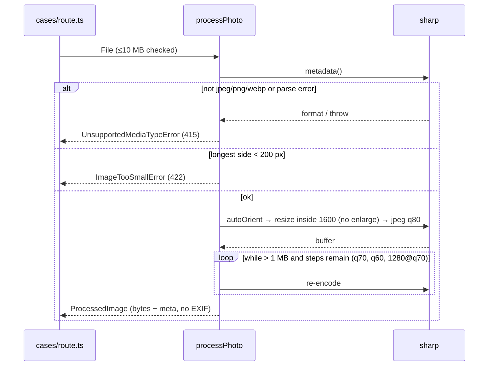
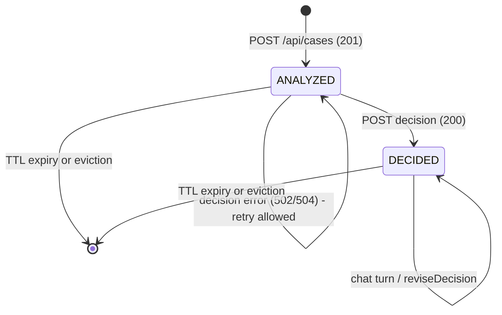
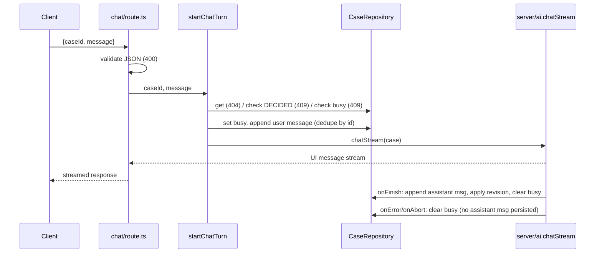

# ADR-001: Backend API, Validation, Image Processing and Case Store

**Date:** 2026-11-25
**Status:** Accepted
**Relates to:** `docs/ADR/000-main-architecture.md`

---

## 1. Scope

**Covers:**
- the three route handlers,
- request parsing and validation,
- the error model,
- image validation and reduction,
- date and window facts,
- the case store,
- configuration loading.

**Does not cover:**
- prompts, model calls, guardrails, the first-message renderer or the chat agent internals
  ([002](002-ai-pipeline.md));
- UI behavior ([003](003-frontend.md)).

---

## 2. Technology Documentation References

Context7 IDs (templates; append `/vxx.x.x` matching `app/package-lock.json`, see 000 §2):
Next.js `/vercel/next.js/vxx.x.x`, sharp `/lovell/sharp/vxx.x.x`, Zod `/colinhacks/zod/vxx.x.x`,
Vitest `/vitest-dev/vitest/vxx.x.x`.

| Library | Context7 ID or official docs | Used for |
|---|---|---|
| Next.js route handlers | https://nextjs.org/docs/app/api-reference/file-conventions/route | `POST` handlers, `request.formData()` |
| Next.js route segment `runtime` | https://nextjs.org/docs/app/api-reference/file-conventions/route-segment-config/runtime | Default `nodejs` runtime (needed by sharp) |
| Next.js `proxyClientMaxBodySize` | https://nextjs.org/docs/app/api-reference/config/next-config-js/proxyClientMaxBodySize | Only relevant if a `proxy.ts` is added (not in v1) |
| sharp resize / operation / output | https://sharp.pixelplumbing.com/api-resize · https://sharp.pixelplumbing.com/api-operation · https://sharp.pixelplumbing.com/api-output | `metadata()`, `autoOrient()`, `resize({fit:'inside', withoutEnlargement})`, `jpeg({quality})` |
| Zod | https://zod.dev | Input schemas, env schema |
| `server-only` | https://nextjs.org/docs/app/getting-started/server-and-client-components | Prevent server modules in client bundles |

---

## 3. Component Design

### 3.1 Layers

1. **Route handlers** (`src/app/api/**/route.ts`) are thin adapters. Each one:
   - parses the request with `server/http`,
   - calls one `server/cases` service,
   - serializes the result or maps the error.

   They contain no business logic. They do not export `runtime`: Node.js is the default.
2. **`server/http`**
   - `parseCaseForm(request)`:
     - checks that `Content-Type` is `multipart/form-data`;
     - rejects a declared `Content-Length` > 10.5 MB with 413 before parsing;
     - reads `formData()`;
     - converts fields to a plain object;
     - extracts exactly one `photo` `File`.
   - `parseJson(request, schema)`.
   - `toErrorResponse(error)` maps `AppError` subclasses to the HTTP table in §5.4. Unknown errors
     become `500 INTERNAL_ERROR`. They are logged with a request id, and their message is not
     leaked.
3. **`server/cases` services** (use cases):
   - `createCaseWithAnalysis(input, photoFile)` → validate → `image.process` →
     `ai.analyzeImage` → `store.create` → summary.
   - `decideCase(caseId)` → `store.get` → if `DECIDED` return existing (idempotent) →
     `facts.compute` → `ai.decide` (includes guardrails) → `ai.renderFirstMessage` → `store.update`.
   - `startChatTurn(caseId, userMessage)` → `store.get` → append user message → `ai.chatStream(case)`.
     The stream's finish handler appends the assistant message and persists any decision revision
     (002 §7).
4. **`server/image`** — `processPhoto(file)` → `ProcessedImage` (§3.3).
5. **`server/store`** — `CaseRepository` (§3.4).
6. **`server/config`** — `getConfig()` parses `process.env` with a Zod schema once (lazy
   singleton). It throws `ConfigError`, naming the missing variables, which maps to `503
   CONFIG_ERROR`.
7. **`lib/shared/dates`**:
   - `todayInZone(tz)` → ISO date;
   - `daysBetween(fromIsoDate, toIsoDate)` → integer, computed on calendar dates (not timestamps)
     so that DST does not shift the result.

### 3.2 Validation rules (shared Zod schema `CaseInputSchema` in `lib/shared`)

| Field | Rule | Polish error message |
|---|---|---|
| `caseType` | enum `RETURN` \| `COMPLAINT`, required | "Wybierz typ zgłoszenia" |
| `category` | enum `LAPTOP`, `SMARTPHONE`, `TABLET`, `MONITOR_TV`, `AUDIO`, `CAMERA`, `WEARABLE`, `GAME_CONSOLE`, `OTHER`; required | "Wybierz kategorię sprzętu" |
| `model` | trimmed string, 2–100 chars | "Podaj nazwę lub model (2–100 znaków)" |
| `purchaseDate` | `YYYY-MM-DD`, valid calendar date, ≤ today in `APP_TIMEZONE`, ≥ 2000-01-01 | "Podaj datę zakupu" / "Data zakupu nie może być z przyszłości" |
| `reason` | trimmed string ≤2000; if `caseType = COMPLAINT` then ≥10 | "Opisz powód reklamacji (min. 10 znaków)" / "Maksymalnie 2000 znaków" |

- The same schema runs on the client (003) and the server. The server is authoritative.
- Polish display labels for the enums live in `lib/shared/labels`. They follow PRD AC-03: "Laptop",
  "Smartfon", "Tablet", "Monitor / TV", "Słuchawki / Audio", "Aparat", "Smartwatch / Wearable",
  "Konsola do gier", "Inne".
- A purchase date at or after 2000-01-01 but outside the policy window is **valid input**. The
  guardrails handle it (002 §5), not validation.

### 3.3 Image processing (`processPhoto`)

1. **Presence and size.** The file must be present and non-empty: otherwise `400
   VALIDATION_ERROR` with `fieldErrors.photo = "Dodaj zdjęcie sprzętu"`. Its size must be ≤ 10 ×
   1024 × 1024 bytes: otherwise `413 FILE_TOO_LARGE`, "Plik przekracza limit 10 MB".
2. **Real format.** Read `sharp(buffer).metadata()`. `format` must be `jpeg`, `png` or `webp`.
   Otherwise, or if sharp throws, return `415 UNSUPPORTED_MEDIA_TYPE`, "Dozwolone formaty: JPG,
   PNG, WEBP". The browser-declared MIME type and the file extension are **ignored**:
   `laptop-1.png` is JPEG bytes and must pass.
3. **Dimension sanity.** Reject a longest side < 200 px with `422 IMAGE_TOO_SMALL`, "Zdjęcie jest
   zbyt małe do oceny (min. 200 px)". Reject more than 50 megapixels with `413`. sharp's default
   `limitInputPixels` also protects against decompression bombs.
4. **Reduce.**
   - Auto-orient from EXIF.
   - Resize with `fit: inside`, a 1600×1600 box and `withoutEnlargement`.
   - Encode as JPEG at quality 80. Metadata is stripped (sharp default; no `keepExif` or
     `withMetadata`).
5. **Byte budget.** If the output is > 1 MB, re-encode at quality 70, then 60. If it is still > 1 MB,
   resize to a 1280 box at quality 70. The last result is used regardless of size (the 1 MB budget
   is a target, PRD AC-13).
6. **Result.** Return `ProcessedImage { bytes, mediaType: 'image/jpeg', width, height, byteSize,
   originalFormat, originalWidth, originalHeight, originalByteSize }`.
7. **Privacy.** Bytes are passed to the analyst and then released. Only the metadata (without
   bytes) is stored on the case.

### 3.4 Case store

The `CaseRepository` interface offers:
- `create(case)`,
- `get(id)` → `Case | null`, which also refreshes `lastAccessAt`,
- `update(id, mutator)`, an atomic read-modify-write within the process,
- `delete(id)`,
- `size()`.

`InMemoryCaseRepository`:
- Backed by a `Map<string, Case>`, held as a `globalThis` singleton (survives dev HMR).
- **TTL:** on every `get`/`create`, entries with `now − lastAccessAt > CASE_TTL_MINUTES` are purged
  lazily. There is no timer.
- **Capacity:** after `create`, while `size > CASE_STORE_MAX`, the entry with the oldest
  `lastAccessAt` is evicted.
- **Concurrency:** Node is single-threaded. Within the process, `update` applies the mutator
  synchronously. Chat turns per case are serialized: a second `POST /api/chat` for a case with a
  stream in progress returns `409 CHAT_BUSY`, tracked by an in-progress flag on the case that is
  cleared on finish or error.
- **Clock:** injectable (`now()` dependency) for tests.

Phase 2 (P2-B) swaps in a SQLite implementation of the same interface. Services do not change.

---

## 4. Data Structures

### 4.1 `Case` (stored)

| Field | Type | Notes |
|---|---|---|
| `id` | UUID v4 string | `crypto.randomUUID()` |
| `status` | `ANALYZED` \| `DECIDED` | |
| `input` | `CaseInput` | Validated, trimmed |
| `imageMeta` | `{ originalFormat, originalWidth, originalHeight, originalByteSize, width, height, byteSize }` | No bytes |
| `analysis` | `ImageAnalysis` | 002 §4.1 |
| `facts` | `DecisionFacts \| null` | Computed at decision time |
| `decision` | `Decision \| null` | 002 §4.2 |
| `decisionHistory` | `{ decision: Decision, at: ISO datetime, trigger: 'INITIAL' \| 'CHAT_REVISION', messageId? }[]` | |
| `messages` | AI SDK UI messages | `messages[0]` is the rendered first message |
| `policyVersion` | string (short SHA-256 of the policy file used) | |
| `promptVersions` | `{ vision: string, decision: string, chat: string }` | Prompt files carry a version header |
| `chatInProgress` | boolean | Serialization flag |
| `createdAt`, `lastAccessAt` | ISO datetime | |

### 4.2 `DecisionFacts`

| Field | Type | Rule |
|---|---|---|
| `submissionDate` | ISO date | `todayInZone(APP_TIMEZONE)` at decision time |
| `daysSincePurchase` | integer ≥ 0 | `daysBetween(purchaseDate, submissionDate)` |
| `windowDays` | 14 \| 730 | Return 14 (R1.1); complaint 730 (24 months ≈ C1.1; see note) |
| `withinWindow` | boolean | `daysSincePurchase ≤ windowDays` (R1.2: day 14 is in time) |
| `deadOnArrivalWindow` | boolean | Complaint only: `daysSincePurchase ≤ 14` (C3.2) |

Note: for complaints, "24 months" is evaluated exactly by calendar. `withinWindow` is true when
`submissionDate ≤ purchaseDate + 24 calendar months`. `windowDays` is informational. Test both
boundary dates.

### 4.3 Response DTOs

- **`CaseSummary`**: `{ caseId, caseType, caseTypeLabel, category, categoryLabel, model,
  purchaseDate, reason }`.
- **`AnalysisDTO`**: `{ summary: string, photoQuality, matchesDeclaredCategory }`. This is a
  subset; the full analysis stays server-side except `summary`, which the UI shows in the "Opis
  zdjęcia (AI)" section.
- **`DecisionDTO`**: `{ value, label, tone: 'positive' | 'negative' | 'warning', daysSincePurchase,
  citedClauses }`.
- **`firstMessage`**: an AI SDK UI message `{ id, role: 'assistant', parts: [{ type: 'text',
  text: <markdown> }] }`.

---

## 5. Interface Contracts

### 5.1 `POST /api/cases`
- **Input:** `multipart/form-data`.
  - Fields: `caseType`, `category`, `model`, `purchaseDate`, `reason` (may be empty string),
    `photo` (single file).
  - Extra fields are ignored. Multiple `photo` entries → `400`.
- **Output:** `201 { caseId, caseSummary: CaseSummary, analysis: AnalysisDTO }`.
- **Errors:**
  - `400 VALIDATION_ERROR` (+ `fieldErrors`)
  - `413 FILE_TOO_LARGE`
  - `415 UNSUPPORTED_MEDIA_TYPE`
  - `422 IMAGE_TOO_SMALL`
  - `502 AI_UNAVAILABLE`
  - `502 AI_INVALID_OUTPUT` (structured output failed schema validation after retries)
  - `504 AI_TIMEOUT` (vision > 20 s)
  - `503 CONFIG_ERROR`
  - `500 INTERNAL_ERROR`
- **Notes:**
  - On any error, no case is created.
  - **Amended by 004 §5:** this step also computes `DecisionFacts`, runs the routing in
    `server/decisions/router.ts` (`RULES` / Luna / vision) and returns `decisionPath` and
    `assessment`. A Luna failure never fails this request.

### 5.2 `POST /api/cases/{caseId}/decision`
- **Input:** path `caseId` (UUID); empty body.
- **Output:** `200 { decision: DecisionDTO, firstMessage }`.
- **Errors:**
  - `400 VALIDATION_ERROR` (malformed id)
  - `404 CASE_NOT_FOUND`
  - `502 AI_UNAVAILABLE` / `502 AI_INVALID_OUTPUT`
  - `504 AI_TIMEOUT` (> 35 s)
  - `503 CONFIG_ERROR`
- **Notes:**
  - Idempotent: if the case is already `DECIDED`, it returns the stored decision and first message
    without calling the model.
  - On paths `RULES` and `FAST` (004), the decision is built in code without any model call.
  - On error the case stays `ANALYZED`, so a retry is possible.

### 5.3 `POST /api/chat`
- **Input:** JSON `{ caseId: UUID, message: UIMessage }`.
  - `message.role` must be `user`.
  - Exactly one text part, trimmed length 1–2000.
  - The client sends only the new message (003 §5).
- **Output:** a UI message stream response from the AI SDK. It carries text parts and the
  `reviseDecision` tool parts. Metadata on finish: `{ decision: DecisionDTO }` (current decision
  after the turn).
- **Errors (before the stream starts, JSON):**
  - `400 VALIDATION_ERROR`
  - `404 CASE_NOT_FOUND` ("Sesja zgłoszenia wygasła. Rozpocznij nowe zgłoszenie.")
  - `409 CASE_NOT_DECIDED`
  - `409 CHAT_BUSY`
  - `503 CONFIG_ERROR`
- **Errors (mid-stream):** an error chunk is sent with the Polish message "Nie udało się uzyskać
  odpowiedzi. Spróbuj ponownie." The user message stays in history. The partial assistant text is
  **not** persisted, so the retry regenerates it.
- **Notes:**
  - Timeouts: first chunk 20 s, total 60 s.
  - The retry from the UI (**Ponów**) resends the same message id. The server detects that the
    last stored message is this same user message and does not duplicate it.

### 5.4 Error model

| Code | HTTP | Polish `message` |
|---|---|---|
| `VALIDATION_ERROR` | 400 | "Popraw zaznaczone pola" (+ `fieldErrors` per field) |
| `CASE_NOT_FOUND` | 404 | "Sesja zgłoszenia wygasła. Rozpocznij nowe zgłoszenie." |
| `CHAT_BUSY` | 409 | "Poczekaj na zakończenie poprzedniej odpowiedzi." |
| `CASE_NOT_DECIDED` | 409 | "Decyzja nie jest jeszcze gotowa." |
| `FILE_TOO_LARGE` | 413 | "Plik przekracza limit 10 MB" |
| `UNSUPPORTED_MEDIA_TYPE` | 415 | "Dozwolone formaty: JPG, PNG, WEBP" |
| `IMAGE_TOO_SMALL` | 422 | "Zdjęcie jest zbyt małe do oceny (min. 200 px)" |
| `AI_UNAVAILABLE`, `AI_INVALID_OUTPUT` | 502 | "Nie udało się przygotować decyzji. Spróbuj ponownie." |
| `AI_TIMEOUT` | 504 | "Nie udało się przygotować decyzji. Spróbuj ponownie." |
| `CONFIG_ERROR` | 503 | "Usługa jest chwilowo niedostępna (błąd konfiguracji)." |
| `INTERNAL_ERROR` | 500 | "Wystąpił nieoczekiwany błąd. Spróbuj ponownie." |

Logging:
- Each request gets a request id, which is logged with every error and returned in the
  `x-request-id` header.
- Logs never contain the API key, photo bytes or the full reason text. They log lengths and ids
  only.

---

## 6. Technical Decisions

### 6.1 Detect image format from bytes, not extension or MIME
**Status:** Accepted
**Date:** 2026-11-25
**Context:** The real example files include a JPEG named `.png`, and browsers derive the MIME type
from the extension. PRD AC-08 is about actual formats.
**Decision:**
- Accept a file only if sharp's `metadata().format` is `jpeg`, `png` or `webp`.
- Ignore the extension and the declared MIME type on the server.
- The client `accept` attribute is only a picker hint.
**Rejected alternatives:**
- Trusting the extension or MIME type: this rejects valid customer files and accepts renamed
  non-images.
- A separate magic-byte library: sharp already parses the header.
**Consequences:**
- (+) Robust against renamed files.
- (-) The full upload must be received before rejecting it, bounded by the 10 MB limit.
**Review trigger:** HEIC support is requested.

### 6.2 Reduction parameters: 1600 px box, JPEG q80, ≤1 MB target
**Status:** Accepted
**Date:** 2026-11-25
**Context:** PRD AC-13 leaves the limits to be confirmed in the ADR. Vision models downscale large
images internally, and token cost grows with resolution.
**Decision:**
- Fit inside 1600×1600 without enlargement.
- Encode as JPEG at quality 80 and step down to the 1 MB target as in §3.3.
- Images smaller than the box are re-encoded (to strip metadata) but not resized.
**Rejected alternatives:**
- 1024 px: fine scratches on large laptop photos may disappear.
- Keeping the original format: PNG screenshots of photos can stay large, and the output type
  would vary.
**Consequences:**
- (+) Predictable payload and cost.
- (+) Uniform input to the model.
- (-) Some loss of fine detail on very large photos.
**Review trigger:** Eval reports show missed defects that are visible in the original, or the
chosen model's documented optimal input size differs.

### 6.3 Explicit 409 for concurrent chat turns
**Status:** Accepted
**Date:** 2026-11-25
**Context:** Overlapping turns on one case would interleave the history. The UI already disables
send while streaming (PRD AC-28), but the server must not rely on that.
**Decision:** Use a per-case in-progress flag. A second concurrent request gets `409 CHAT_BUSY`.
**Rejected alternatives:** Queueing turns: added complexity for a case the UI prevents.
**Consequences:**
- (+) Consistent history.
- (-) A crashed stream must clear the flag. The flag is cleared in `finally`/`onError`/`onAbort`
  handlers, and it auto-expires after 90 s.
**Review trigger:** Multiple users collaborating on one case.

---

## 7. Diagrams

### Component diagram
```mermaid
flowchart TB
  subgraph Routes[src/app/api]
    RC[cases/route.ts]
    RD[cases/[caseId]/decision/route.ts]
    RCH[chat/route.ts]
  end
  subgraph Http[server/http]
    PF[parseCaseForm]
    PJ[parseJson]
    ER[toErrorResponse]
  end
  subgraph Cases[server/cases]
    S1[createCaseWithAnalysis]
    S2[decideCase]
    S3[startChatTurn]
  end
  IMG[server/image.processPhoto]
  FACTS[lib/shared/dates + facts]
  AI[server/ai]
  REPO[[CaseRepository]]
  MEM[InMemoryCaseRepository]
  CFG[server/config]
  RC --> PF --> S1
  RD --> S2
  RCH --> PJ --> S3
  RC & RD & RCH --> ER
  S1 --> IMG
  S1 --> AI
  S2 --> FACTS
  S2 --> AI
  S3 --> AI
  S1 & S2 & S3 --> REPO
  MEM -. implements .-> REPO
  AI --> CFG
  MEM --> CFG
```

### Image processing sequence


### Case lifecycle


### Chat request handling


---

## 8. Testing Strategy

### Test scenarios for this area

| Scenario | Type | Input | Expected output | Edge cases |
|---|---|---|---|---|
| Schema accepts valid return | Unit | Return, empty reason, date today | Parses; reason `""` | Model with surrounding spaces → trimmed |
| Complaint reason rule | Unit | Complaint, reason 9 chars / 10 chars | Error / ok | Whitespace padding not counted |
| Future date | Unit (fake clock 2026-11-25 Europe/Warsaw) | `2026-11-26` | Error "Data zakupu nie może być z przyszłości" | 23:30 UTC on 2026-11-25 = 2026-11-26 in Warsaw → `2026-11-26` valid |
| Invalid calendar date | Unit | `2026-02-30` | Error | `2000-01-01` boundary |
| `daysBetween` | Unit | Across DST change (2026-10-20 → 2026-11-05) | 16 | Same day → 0 |
| Return window boundary | Unit | 14 days / 15 days | `withinWindow` true / false | — |
| Complaint window boundary | Unit | Purchase 2024-11-25, submission 2026-11-25 / 2026-11-26 | true / false | Purchase 2024-02-29 |
| Format detection | Unit (real sharp) | `laptop-1.png`, `laptop-2.webp`, `phone-*.jp(e)g` | Accepted; `originalFormat` = jpeg/webp/jpeg | Text file with `.jpg` → 415 |
| Reduction | Unit (real sharp) | `laptop-1.png` (3024×3135) | Longest side 1600, JPEG, ≤1 MB, `metadata().exif` undefined | `phone-2.jpeg` 387×516 stays 387×516 |
| Size limit | Unit | Buffer 10 MB + 1 byte | 413 | Exactly 10 MB → passes size check |
| Store TTL | Unit (fake clock) | Create, advance 121 min, get | `null` | Access at 119 min refreshes TTL |
| Store capacity | Unit | Max 3, create 4 | Oldest-accessed evicted | Recently `get` entry survives |
| `POST /api/cases` happy path | Integration (mock vision model from capture) | Valid multipart + `phone-1.jpg` | 201 with `caseId`, `analysis.summary` | — |
| `POST /api/cases` validation | Integration | Missing `photo`, two photos, bad category | 400 with matching `fieldErrors` | No case created (`store.size()` unchanged) |
| Vision timeout | Integration (mock model that never resolves, fake timers) | Valid input | 504 `AI_TIMEOUT` | No case created |
| Decision idempotency | Integration | Call decision twice | Second call returns same decision; model called once | — |
| Decision retry after failure | Integration | First call mock throws 5xx, second succeeds | 502 then 200; case `DECIDED` | — |
| Chat 404/409 | Integration | Unknown id; undecided case; concurrent request | 404; 409 `CASE_NOT_DECIDED`; 409 `CHAT_BUSY` | Busy flag cleared after stream error |
| Chat retry dedupe | Integration | Same user message id sent twice after a mid-stream error | History contains it once | — |
| Error body shape | Integration | Each error code | `{ error: { code, message } }` with Polish message, `x-request-id` header | 500 does not leak stack |

### Technical acceptance criteria

- **TAC-001-01** The server accepts every file in `assets/example-images/` for both case types. The
  reduced output for each is JPEG with longest side ≤ 1600 px and no EXIF.
- **TAC-001-02** A non-image file renamed to `.jpg` returns `415 UNSUPPORTED_MEDIA_TYPE`, and no
  model call is made (asserted on the mock).
- **TAC-001-03** All error responses match `{ error: { code, message, fieldErrors? } }` and include
  an `x-request-id` header.
- **TAC-001-04** `daysBetween` and window functions pass the boundary tables in §8 using an
  injected clock and `Europe/Warsaw`.
- **TAC-001-05** No log line produced during the integration suite contains the test API key, the
  substring `sk-or-`, or base64 image data. This is asserted by capturing the logger.
- **TAC-001-06** `POST /api/cases/{id}/decision` called twice invokes the decision model exactly
  once.
