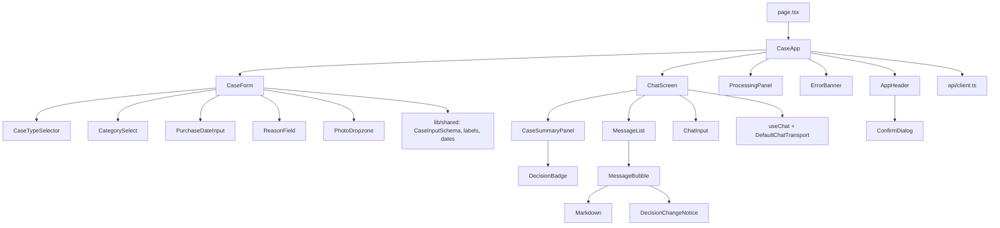
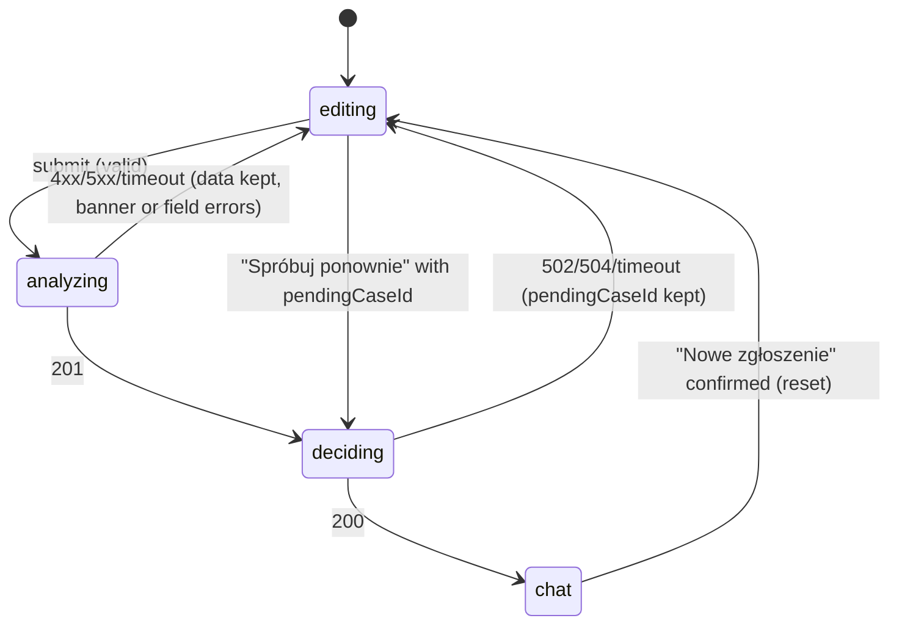
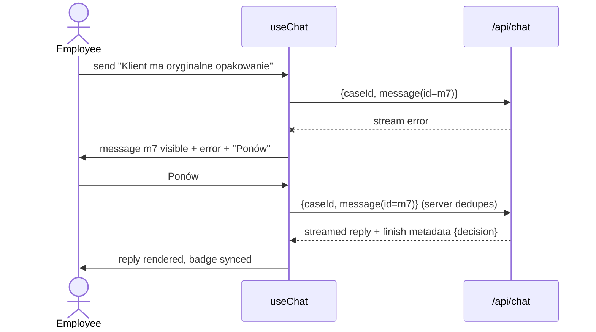

# ADR-003: Frontend — Screens, Client State, Chat Client and Styling

**Date:** 2026-11-25
**Status:** Accepted
**Relates to:** `docs/ADR/000-main-architecture.md`

---

## 1. Scope

**Covers:**
- the single-page client application: the state machine across form → processing → chat;
- the form and photo picker, with client validation;
- the API calls for the two-step submission;
- the chat client (streaming, tool parts, retry);
- Markdown rendering;
- styling with the design tokens;
- accessibility and responsiveness.

**Does not cover:** server contracts ([001](001-backend-api.md)) or agent behavior
([002](002-ai-pipeline.md)). Functional UI behavior is defined in PRD §9; this ADR defines how it
is built.

---

## 2. Technology Documentation References

| Library | Context7 ID or official docs | Used for |
|---|---|---|
| Next.js App Router | `/vercel/next.js` · https://nextjs.org/docs/app | `layout.tsx`, `page.tsx`, `next/font/local`, client components |
| AI SDK UI chatbot | `/websites/ai-sdk_dev` · https://ai-sdk.dev/docs/ai-sdk-ui/chatbot | `useChat` (`@ai-sdk/react`), `DefaultChatTransport` + `prepareSendMessagesRequest`, message parts, `message.metadata`, status, error, `regenerate` |
| react-markdown | `/remarkjs/react-markdown` · https://github.com/remarkjs/react-markdown | Safe Markdown rendering (no raw HTML) |
| Tailwind CSS v4 | `/tailwindlabs/tailwindcss.com` · https://tailwindcss.com/docs/theme | `@theme` tokens, `@tailwindcss/postcss` |
| Zod | `/colinhacks/zod` · https://zod.dev | Shared `CaseInputSchema` for client validation |
| Playwright | `/microsoft/playwright` · https://playwright.dev | E2E specs, `setInputFiles` with `assets/example-images/*` |
| Vitest | `/vitest-dev/vitest` · https://vitest.dev | Component tests in jsdom |
| Testing Library | https://testing-library.com/docs/react-testing-library/intro | Component tests |
| Design reference | `docs/design-guidelines.md`, `assets/design-tokens.json`, `assets/homepage.png` | Tokens, components, QA reference |

---

## 3. Component Design

### 3.1 Page and state machine

`src/app/page.tsx` renders `<CaseApp />`, a client component that owns the top-level state. There
is no routing between screens: one URL `/`. A reload returns to the empty form (PRD AC-36).

| State | Data held | UI |
|---|---|---|
| `editing` | `formValues`, `photoFile`, `photoPreviewUrl`, `fieldErrors`, `bannerError?`, `pendingCaseId?` | Form screen |
| `analyzing` | as above (locked) | Form + processing panel, stage 1 "Analizuję zdjęcie…" |
| `deciding` | + `caseId`, `caseSummary`, `analysis` | Processing panel, stage 2 "Przygotowuję decyzję…" |
| `chat` | `caseId`, `caseSummary`, `analysis`, `decision`, `firstMessage`, `photoPreviewUrl` | Chat screen |

Transitions:
- `editing` → `analyzing` on a valid submit.
- `analyzing` → `deciding` on `201`.
- `deciding` → `chat` on `200`.
- Any 4xx/5xx in `analyzing` → `editing` with a banner or field errors. Data and photo are kept.
- A 502/504 in `deciding` → `editing` with the banner and `pendingCaseId` set. **Spróbuj ponownie**
  then calls only the decision endpoint (000 Decision 8.2).
- A 404 in `deciding` → clear `pendingCaseId` and re-submit the whole form on retry.
- Editing any field or the photo while `pendingCaseId` is set clears `pendingCaseId`. The changed
  data must be analysed again.
- `chat` → `editing` (empty) on a confirmed **Nowe zgłoszenie**. This revokes the preview object
  URL and resets all state.

The state machine is implemented as a reducer: pure, and unit-tested without rendering.

### 3.2 Components (`src/components/`)

| Component | Responsibility |
|---|---|
| `CaseApp` | Reducer, API calls (`api/client.ts`), screen switch |
| `AppHeader` | Product name and logo (left). **Nowe zgłoszenie** button (right) only in `chat` |
| `CaseForm` | Fields per PRD §9.2. Client validation with the shared `CaseInputSchema` (on blur and on submit). Submit disabled until valid (PRD AC-11) and while processing (AC-12) |
| `CaseTypeSelector` | Two radio cards (native radio inputs in a `fieldset` with `legend`): "Zwrot", "Reklamacja". None preselected (AC-02) |
| `CategorySelect` | Native `<select>` with placeholder option "Wybierz kategorię" and the 9 labels from `lib/shared/labels` |
| `PurchaseDateInput` | Native `<input type="date">`, `max` = today in Europe/Warsaw (computed client-side with the shared helper) |
| `ReasonField` | Textarea with a counter ("{n}/2000"); "(wymagane)"/"(opcjonalne)" and helper text switch with case type; content kept when the type changes (AC-07) |
| `PhotoDropzone` | Drop area + hidden file input (`accept="image/jpeg,image/png,image/webp"`), keyboard-operable. Client-side checks: size ≤10 MB, and type by MIME **or** extension (only a hint; the server decides by content). Shows thumbnail (object URL), file name, size, **Zmień**, **Usuń** (AC-10). Helper text switches with case type |
| `ProcessingPanel` | Two-stage progress (stage 1/2 with check marks), spinner, `aria-live="polite"` announcements |
| `ErrorBanner` | Banner with the server `message` and **Spróbuj ponownie** |
| `ChatScreen` | Two-column layout ≥1024 px (summary left 320 px, conversation right); stacked < 1024 px (collapsible summary on top) |
| `CaseSummaryPanel` | Case type, category, model, purchase date + "{n} dni temu", thumbnail (click → enlarged dialog), `DecisionBadge`, `DecisionPathLabel`, and a collapsible assessment section that depends on `decisionPath` (004). `LLM` / `LLM_ESCALATED`: "Opis zdjęcia (AI)" with `analysis.summary`. `FAST`: "Ocena automatyczna", one row per question with a Polish answer and certainty in % (e.g. "Ślady użytkowania: brak — 93%"). `LLM_ESCALATED` also lists the uncertain items. `RULES`: "Zdjęcie nie było analizowane — termin minął" |
| `DecisionPathLabel` | Small text under the badge: `FAST` → "Szybka ocena automatyczna", `LLM` → "Pełna analiza AI", `LLM_ESCALATED` → "Pełna analiza AI (niepewna ocena wstępna)", `RULES` → "Reguła terminu". Shadow results are never shown |
| `DecisionBadge` | Label + icon + tone (positive / negative / warning); meaning never conveyed by color alone |
| `MessageList` | Renders `messages` from `useChat`; auto-scrolls to bottom on new content unless the user has scrolled up |
| `MessageBubble` | Agent left, user right, timestamp. Text parts → `Markdown`. `reviseDecision` tool parts → `DecisionChangeNotice`. Typing indicator while streaming with no text yet |
| `DecisionChangeNotice` | "Decyzja zmieniona: {fromLabel} → {toLabel}", the reason, and the disclaimer (002 §7) |
| `Markdown` | react-markdown with raw HTML disabled, links rendered as plain text (no navigation out of the app), allowed elements: headings, paragraphs, strong, em, lists, list items, code |
| `ChatInput` | Textarea (auto-grow up to 6 lines). Enter sends, Shift+Enter inserts a newline. Send disabled for empty/whitespace input, while streaming, and over 2000 chars (AC-27, AC-28, AC-32). Counter shown from 1800 chars |
| `ConfirmDialog` | Native `<dialog>` with focus trap: "Bieżąca rozmowa zostanie utracona." [Anuluj] [Rozpocznij nowe] |

### 3.3 API client (`src/components/api/client.ts`)

- `createCase(formValues, photoFile)`: posts `FormData` to `/api/cases`. Returns a parsed DTO, or
  throws `ApiError { status, code, message, fieldErrors }`.
- `decideCase(caseId)`: posts to `/api/cases/{id}/decision`.
- Client-side abort: 30 s for `createCase`, 40 s for `decideCase`. These are the server budget plus
  margin. A client timeout shows the same banner as a 504.

### 3.4 Chat client

- `useChat` from `@ai-sdk/react` is initialised once per case:
  - `id` = `caseId`;
  - `messages` = `[firstMessage]`;
  - `transport` = `DefaultChatTransport` pointing to `/api/chat`.
- **Request shaping.** `DefaultChatTransport({ api: '/api/chat', prepareSendMessagesRequest })`
  returns the body `{ caseId: id, message: messages[messages.length - 1] }`. This is the documented
  "send only the last message" pattern, verified in Context7 `/websites/ai-sdk_dev`. Full history is
  not sent, because the server owns it (000 Decision 8.3).
- **Status.** `status` drives the typing indicator and disables input (`submitted` / `streaming`).
- **Errors.** On error, the failed user message stays visible with an inline error and **Ponów**.
  **Ponów** re-sends the same message. The server deduplicates by message id (001 §5.3).
  - On `404 CASE_NOT_FOUND`, the inline error shows the server message and a **Nowe zgłoszenie**
    action instead of **Ponów**.
- **Badge update.** The badge updates from the message finish metadata `decision` (001 §5.3).
  When a `reviseDecision` tool part with `ok: true` arrives, it also updates immediately.

### 3.5 Styling

- **Tailwind v4.** Tokens are defined in `src/app/globals.css` with `@theme`. They map
  `assets/design-tokens.json` to the `--color-*`, `--font-*`, `--radius-*` and `--spacing-*`
  namespaces. Use `brand.primary` `#79003C` for the primary button and links, `tint.pink`
  `#FFE5F2` for secondary surfaces, `background.light` `#F7F7F8` for the page, radius `lg` 16 px
  for buttons and cards, and radius `sm` 8 px for inputs.
- **Font.** Nunito Sans comes from `assets/fonts/nunito-sans/*.woff2`, copied to `public/fonts/`
  and loaded with `next/font/local`. No external font CDN is used.
- **Status colors.** The token file has no success, error or warning colors (its `$meta.notes`).
  The app defines these app-level tokens in `@theme`. Each meets WCAG AA contrast (≥4.5:1) for text
  on its tint, to be verified with a contrast checker at implementation time:

  | Token | Text | Background tint |
  |---|---|---|
  | `--color-status-positive` | `#1E6B34` | `#E6F4EA` |
  | `--color-status-negative` | `#A1192B` | `#FCE8EA` |
  | `--color-status-warning` | `#7A4B00` | `#FFF4D6` |

  Form error text uses `--color-status-negative`. These tokens are recorded in
  `docs/design-guidelines.md` as an app addition.
- **Brand notice.** `docs/design-guidelines.md` marks the logo as a third-party trademark for
  internal course reference only. The header shows the text product name "Hardware Service
  Decision Copilot" as the primary identity. The reference logo may be shown only in course demos
  on the VM, never in a published build.

### 3.6 Accessibility and responsiveness

- Every input has a `<label>`.
- Errors are linked with `aria-describedby` and announced via `aria-live="assertive"` on submit.
- After a failed submit, focus moves to the first invalid field.
- The conversation region is `role="log"` with `aria-live="polite"`.
- The breakpoint is 1024 px between stacked and two-column chat layouts.
- There is no horizontal scroll from 360 px to 1920 px (PRD AC-39). Long model names and Markdown
  wrap with `overflow-wrap: anywhere`.
- Touch targets are ≥ 44 px.

---

## 4. Data Structures

| Structure | Fields | Source |
|---|---|---|
| `FormValues` | `caseType?`, `category?`, `model`, `purchaseDate`, `reason` (strings; enums optional until chosen) | Local state |
| `PhotoState` | `file`, `previewUrl` (object URL), `name`, `sizeBytes` | Local state; URL revoked on remove/reset |
| `FieldErrors` | `Partial<Record<keyof FormValues \| 'photo', string>>` | Zod issues mapped to Polish messages from `lib/shared`, or server `fieldErrors` |
| `CaseSummary`, `AnalysisDTO`, `DecisionDTO`, `firstMessage` | See 001 §4.3 | Server |
| Chat messages | AI SDK UI messages (`id`, `role`, `parts`) | `useChat` |

---

## 5. Interface Contracts

Consumed endpoints (001 §5):
- `POST /api/cases`: `multipart/form-data` built from `FormValues` + `photo`. Enum values are sent
  as constants (e.g. `RETURN`), never as Polish labels.
- `POST /api/cases/{caseId}/decision`: empty body.
- `POST /api/chat`: `{ caseId, message }` via the `useChat` transport. The response is a UI message
  stream.

Exposed: nothing. The app has a single page `/`.

---

## 6. Technical Decisions

### 6.1 Native form controls instead of a component library
**Status:** Accepted
**Date:** 2026-11-25
**Context:** The form needs a select, a date picker, radios and a dialog. Accessibility and speed
matter more than custom visuals in a PoC.
**Decision:** Use native `<select>`, `<input type="date">`, radio inputs and `<dialog>`, styled with
Tailwind tokens. There is no shadcn/ui or other component library.
**Rejected alternatives:**
- shadcn/ui: extra generated code and dependencies for 5 controls.
- A custom date picker: accessibility and locale work for no PRD benefit.
**Consequences:**
- (+) Built-in accessibility, mobile pickers and minimal code.
- (-) The date picker's look differs per browser.
- (-) The date display format follows the browser locale. The value is always ISO.
**Review trigger:** UX review requires a unified date picker, or the brand reference demands custom
controls.

### 6.2 Server-owned chat history with `useChat` sending only the last message
**Status:** Accepted
**Date:** 2026-11-25
**Context:** 000 Decision 8.3 keeps the context on the server. By default, `useChat` sends all
messages.
**Decision:** Customise the transport request to `{ caseId, message }`. The client keeps the
messages only for display.
**Rejected alternatives:** Send everything and ignore it on the server: wasted bandwidth and a
misleading contract.
**Consequences:**
- (+) Small requests.
- (+) A clear trust boundary.
- (-) Client and server histories can diverge after a client-side error. The server is
  authoritative, and a reload resets the session anyway.
**Review trigger:** Phase 2 history view: load messages from the server on open.

### 6.3 Badge driven by finish metadata, with the tool part as an early signal
**Status:** Accepted
**Date:** 2026-11-25
**Context:** PRD AC-31 requires the badge to show the revised decision.
**Decision:** The server sends the current `DecisionDTO` in message finish metadata on every turn,
and the client sets the badge from it. A successful `reviseDecision` tool part updates the badge
earlier.
**Rejected alternatives:** A separate polling GET for the case: extra endpoint and latency.
**Consequences:**
- (+) Correct even if the tool part is not rendered.
- (+) Uses the documented message-metadata mechanism. The server returns metadata from the
  `messageMetadata` callback of `toUIMessageStream` on the `finish` part, and the client reads
  `message.metadata` (typed via `UIMessage<Metadata>`). Verified in Context7 `/websites/ai-sdk_dev`.
- (-) Metadata arrives only at the end of the stream, so the tool part is still needed for an
  immediate update.
**Review trigger:** The metadata API changes, or more case fields need syncing.

---

## 7. Diagrams

### Component diagram

### Client state machine

### Chat retry sequence

---

## 8. Testing Strategy

### Test scenarios for this area

| Scenario | Type | Input | Expected output | Edge cases |
|---|---|---|---|---|
| Reducer transitions | Unit | Each event from each state | Next state per §3.1 diagram | Edit while `pendingCaseId` set clears it |
| Submit disabled until valid | Component (jsdom) | Fill fields one by one | Button enabled only after the last required field + photo (AC-11) | Return without reason → enabled |
| Reason requirement switch | Component | Complaint with 5-char reason → switch to Return | Error and "(wymagane)" disappear, text kept (AC-07) | Switch back → error reappears on blur |
| Future date | Component (fake date 2026-11-25) | `2026-11-26` | "Data zakupu nie może być z przyszłości" (AC-05) | `max` attribute = `2026-11-25` |
| Photo checks | Component | 11 MB file; `.gif`; valid jpeg | Limit message (AC-09); format message (AC-08); thumbnail + name + Zmień/Usuń (AC-10) | `laptop-1.png` (JPEG with .png name) accepted by client hint |
| Server field errors | Component (mocked fetch) | 400 with `fieldErrors.model` | Message under model field, focus moves there | — |
| AI failure banner | Component (mocked fetch) | 504 on decision | Form visible, values + photo kept, banner text from AC-33, retry calls only `/decision` | 404 on retry → full resubmit |
| First message render | Component | `firstMessage` Markdown | Headings, lists and bold rendered; no literal `#`/`**` visible (AC-26) | `<script>` in text rendered as text |
| Chat input keys | Component | Enter / Shift+Enter / whitespace / 2001 chars | Send / newline / blocked / blocked (AC-27, AC-32) | — |
| Streaming state | Component (mocked transport) | Status `streaming` | Typing indicator, send disabled (AC-28) | — |
| Decision change notice | Component | Tool part `ok:true` | "Decyzja zmieniona: … → …" + disclaimer; badge updated (AC-31) | `ok:false` → no notice, badge unchanged |
| New case | Component | Click Nowe zgłoszenie → Anuluj / Rozpocznij nowe | Stays / empty form (AC-35) | Object URL revoked |
| E2E return | E2E (real stack) | Return, `phone-1.jpg`, 3 days ago | Stages visible in order; chat with badge and first message containing "Uzasadnienie", "Kolejne kroki" and the disclaimer; follow-up question answered | Screenshot each screen |
| E2E complaint | E2E | Complaint, `laptop-2.webp`, reason ≥10 chars | Chat opens; badge label from complaint set | — |
| E2E expired return | E2E | Return, 30 days ago, `phone-3.jpeg` | Badge "Zwrot odrzucony", text cites R1.3 (AC-20) | — |
| E2E validation | E2E | Empty submit attempt, future date | Inline errors, no network request to `/api/cases` | — |
| E2E responsive | E2E | Viewports 360×800, 1280×800 | No horizontal scroll (`scrollWidth ≤ clientWidth`) on both screens (AC-39) | — |

*Amendment A5:* component tests that need API responses use only real captures of our own three
endpoints (running app, real OpenRouter), stored in `app/tests/fixtures/api-captures/` with a
`.meta.json` per capture. Derived variants (for example a 504) carry `derived-from`.

### Technical acceptance criteria

- **TAC-003-01** No component renders raw HTML from model output. No `dangerouslySetInnerHTML` is
  present in `src/` (lint rule `react/no-danger`).
- **TAC-003-02** Every chat request body captured in component tests contains exactly the keys
  `caseId` and `message`.
- **TAC-003-03** All visible UI strings come from Polish string constants. No English UI text is
  rendered: E2E checks the page text against a list of forbidden English words such as "Submit",
  "Loading" and "Error".
- **TAC-003-04** Lighthouse/axe accessibility check of both screens reports no violations of
  critical or serious impact. *Amendment A1:* the tool is `@axe-core/playwright` run inside the
  E2E suite; the spec fails on any violation with impact `critical` or `serious`.
- **TAC-003-05** Manual QA screenshots of the form, processing state and chat screen are compared
  against `assets/homepage.png` and `docs/design-guidelines.md`. The primary button color is
  `#79003C`, the font is Nunito Sans and the button radius is 16 px.
