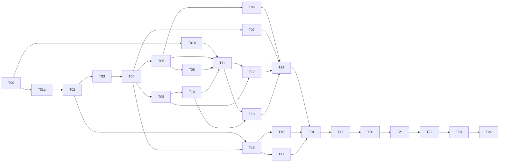

# Implementation Plan — Hardware Service Decision Copilot (PoC)

> **Status: APPROVED and in execution (G1 passed 2026-11-26: the user set the goal "implement this
> plan", which approves A1–A6 and authorizes execution and agents).** Pushing, opening a PR and
> merging stay behind G3; the mode switch stays behind G4.

| | |
|---|---|
| Plan name | `hsdc-poc` (briefs `docs/.agent-briefs/hsdc-poc-<task>.md`, logs `.agent-logs/hsdc-poc-<task>.log`) |
| Scope | The whole PoC defined by [PRD](../PRD.md) (AC-01…AC-47) and [ADR 000–004](../ADR/) |
| Created | 2026-11-26 |
| Orchestrator | Claude Opus 5.5 (Claude Code session) |
| Branch / PR | `feat/hsdc-poc` cut from `design_system`; **one PR** to `main` for the whole application (user decision 2026-11-26) |
| Tracking | The **Status** column below is authoritative. After approval, one GitHub Issue per row; issue IDs are added to the Task column and to the orchestrator's task list |

---

## 1. Baseline (verified 2026-11-26)

### 1.1 What exists

| Item | Observed state |
|---|---|
| `app/` | Only `README.md` (course checklist). No `package.json`, source, tests or entry point. **Nothing to build or run yet**, so there are no baseline test failures |
| Specs | `docs/PRD.md`, `docs/ADR/000…004`, `docs/policies/*.md`. All **untracked**, on branch `design_system` |
| Design | `docs/design-guidelines.md`, `assets/design-tokens.json`, `assets/homepage.png`, `assets/logo.png`, `assets/fonts/nunito-sans/*`. Committed on `design_system`, **not on `main`** (6 commits ahead) |
| Test images | `assets/example-images/` (5 photos + rules in `README.md`). `laptop-1.png` is JPEG bytes |
| Unrelated working-tree items (keep untouched) | Modified `.agents/skills/source-verified-research/scripts/md2pdf.sh`. Untracked nested clone `jsystems-ai-programming-2026-11/`, which agents must not read or edit |
| Instructions | Org instructions (course admin), root `AGENTS.md`, `CLAUDE.md` (`@AGENTS.md` + Context7 rule), `.github/copilot-instructions.md` and `.github/instructions/*.md` (Copilot only). No user-level `~/.claude/CLAUDE.md`, `~/.codex/AGENTS.md` or OpenCode global rules. No nested `AGENTS.md` yet |
| Custom agent roles | None (`.claude/agents/` absent). The available Claude skills include `write-agents-md`, `code-review` and `security-review` |
| CI | `.github/workflows/pr-agent-azure-review.yml` (PR-Agent review on PR events, if repository variables are set) |
| Harness permissions | `.claude/settings.json` denies `rm`, `curl`, `wget`, `env`/`printenv`, reading `.env*` (except `.env.example`), force-push and pushing to `main`. `plansDirectory` = `./docs/plans`. Worktree creation asks first |
| `.gitignore` | Ignores `.agent-briefs/`, which conflicts with committing briefs (decision D3). Has no entry for `.agent-logs/` |

### 1.2 Verified commands and tools

| Command | Result |
|---|---|
| `node --version` / `npm --version` | v24.21.0 / 11.19.0 |
| `git --version` / `gh --version` | 2.53.0 / 2.102.0. `gh auth status`: logged in as `matsadowski`, permission ADMIN on `matsadowski/jsystems-ai-programming-2026-11` |
| `gh repo view … --json hasIssuesEnabled` | `false`. Issues are **disabled**; enabling them is part of T00 after approval |
| `opencode --version` / `opencode models` | 1.19.0. Lists `openrouter/openai/gpt-6-luna`, `opencode/mimo-v2.6-flash-free`, `opencode/deepseek-v4.1-flash-free` and `openrouter/anthropic/claude-{sonnet,opus,haiku}-5.5` |
| `opencode run --help` | Supports `-m`, `-f`, `--title`, `--format json`, `-c`/`-s`, `--auto`, `--dir` |
| `playwright-cli --help` | v0.1.25 is available, for manual QA |
| `codex --version` | 0.162.1 is available, as an optional independent reviewer |
| `ctx7` | Not installed globally. `npx ctx7` hit the anonymous monthly quota on 2026-11-25. **Context7 MCP works** in Claude Code (verified 2026-11-25) |
| `npx create-next-app@latest --help` | Supports `--ts --tailwind --eslint --app --src-dir --use-npm --import-alias --disable-git --skip-install --yes` |
| OpenRouter model slugs | `anthropic/claude-sonnet-5.5`, `anthropic/claude-opus-5.5` and `openai/gpt-6-luna-decisions` (model page) exist |

The build, test and startup commands of the application do not exist yet. T02 creates them and
must record their first real runs.

---

## 2. Decisions taken for this plan

| ID | Decision | Source |
|---|---|---|
| D1 | Branch `feat/hsdc-poc` from `design_system` (it carries the tokens and assets). One PR to `main` at the end. The PR therefore also contains the 6 `design_system` commits (see C1) | User, 2026-11-26 |
| D2 | Enable GitHub Issues **after** plan approval and create one issue per row | User, 2026-11-26 |
| D3 | Commit briefs under `docs/.agent-briefs/` (add a `.gitignore` exception) and ignore `.agent-logs/` | User, 2026-11-26 |
| D4 | The user's OpenRouter key with credits is available. The user writes it into `app/.env` personally; agents never read `.env` | User, 2026-11-26 |
| D5 | Plan name `hsdc-poc`. The prompt's file-name template had no name, so the orchestrator chose one | Orchestrator |
| D6 | LLM slugs: `VISION_MODEL=anthropic/claude-sonnet-5.5`, `DECISION_MODEL=anthropic/claude-opus-5.5` (verified to exist). `LUNA_MODEL=openai/gpt-6-luna-decisions` | ADR [000 §7](../ADR/000-main-architecture.md#7-environment-variables) + verification |
| D7 | Default `DECISION_MODE=shadow`. Switching to `gated` is a user decision after the eval (T20) | [ADR-004 §3.1](../ADR/004-confidence-gated-decisions.md#31-modes-decision_mode), [PRD §12.3](../PRD.md#123-open-questions) |

| D8 | (2026-11-26, supersedes D6 for runtime) The user's OpenRouter account guardrail blocks all Anthropic models (404 "Model blocked by guardrail"). `VISION_MODEL` and `DECISION_MODEL` are `openai/gpt-6-luna`, verified to accept an image and a strict JSON schema (HTTP 200, Polish output) | User, 2026-11-26 |
| D9 | (2026-11-26) Luna Decisions returns 401 from its upstream provider ("OpenAI account ... deactivated"): provider outage. Fallback scope 1 (§7) applies: `DECISION_MODE=llm_only` in `.env.example`, no Luna captures, no gated E2E, no Luna eval. ADR-004 code stays, unit-tested. AC-41 and AC-44 (FAST path observable at runtime) are BLOCKED (provider) | User, 2026-11-26 |
| D10 | PR base (C1): option (b), a `design_system` → `main` PR first, then `feat/hsdc-poc` → `main`. Push/PR still need the explicit G3 go-ahead | User, 2026-11-26 |

| D11 | (2026-11-26) Luna Decisions recovered (HTTP 200, real captures). Fallback 1 is reverted: default `DECISION_MODE=shadow` again (D7); the `--luna` eval part runs and its report goes to the user before any switch to `gated` (G4, TAC-004-06) | User, 2026-11-26 |
| D12 | Eval matrix uses realistic, condition-neutral model names per example file (identity only, never condition), so the category match is not UNCERTAIN by construction | User, 2026-11-26 |

| D13 | (2026-11-26, review design note 1) `reviseDecision` also enforces G3/G6 analogues: a positive decision (`ACCEPT`, `REPAIR`, `REPLACE`, `REFUND`) is refused when the stored analysis shows insufficient evidence (G3/G3c) or, for `ACCEPT`, clear signs of use / not resaleable (G6), unless the tool input states the basis is a physical inspection. ADR 002 §7 amendment | User, 2026-11-26 |
| D14 | (2026-11-26, review design note 2) FAST-path injection risk accepted as in ADR 004; checked by the Luna eval injection case before any switch to `gated` | User, 2026-11-26 |

| D15 | (2026-11-26, gate G4) After the Luna eval (no threshold meets the exit criteria; 3 unsafe disagreements at 0.80), the default stays `DECISION_MODE=shadow` | User, 2026-11-26 |

### 2.1 Proposed ADR amendments (need approval with this plan)

These fill gaps where the ADRs leave an implementing agent unsure. They are **not** assumed until
you approve them. On approval, T00 writes them into the named ADR.

| ID | Gap | Proposal | Target |
|---|---|---|---|
| A1 | ADR 003 TAC-003-04 names "Lighthouse/axe" without choosing a tool | Use `@axe-core/playwright` inside the E2E suite, failing on `critical` and `serious` violations | ADR 003 §8 |
| A2 | AC-41/AC-44 (fast path) cannot be forced in a real E2E run, because Luna confidence on real photos is not under test control | A gated E2E spec runs a second server (`DECISION_MODE=gated`, port 3001). It asserts invariants: the path label is `FAST` or `LLM_ESCALATED`; if `FAST`, the decision arrives within 5 s and "Ocena automatyczna" is shown; if escalated, the uncertain items are listed. A deterministic `FAST` case is covered by integration tests (captured Luna responses) and by the T20 eval | ADR 004 §10 |
| A3 | AC-45 (a Luna failure in shadow mode does not affect the user) needs a real-stack check without mocks | Manual QA run with `LUNA_TIMEOUT_MS=1` against the real server, which forces a genuine timeout. The decision and status must be unchanged | ADR 004 §10 |
| A4 | The eval spends real credits with no budget | `EVAL_MAX_COST_USD` (default `5`). The runner sums the `usage.cost` reported by OpenRouter and stops before exceeding it, recording the stop in the report | ADR 002 §6.3 |
| A5 | Component tests need API responses, and AGENTS.md requires that mocks of endpoints come from real captures | T14 captures real responses of our own three endpoints (running app, real OpenRouter) into `app/tests/fixtures/api-captures/` with meta. Component tests use only these | ADR 003 §8 |
| A6 | Claude Code does not auto-load a nested `AGENTS.md` | Create `app/AGENTS.md` (stack rules) **and** `app/CLAUDE.md` containing `@AGENTS.md`. OpenCode and Codex read `AGENTS.md` directly | ADR 000 §3 |

---

## 3. Contradictions and ambiguities found

Checked across the plan, PRD, ADR 000–004, root `AGENTS.md`/`CLAUDE.md`, `.gitignore` and
`.claude/settings.json`.

| # | Finding | Where | Resolution in this plan |
|---|---|---|---|
| C1 | One PR from a branch cut from `design_system` to `main` also carries 6 unrelated design/research commits | D1 vs git state | **Needs your choice at the PR gate (T23):** (a) accept a mixed PR; (b) open a `design_system` → `main` PR first and merge it; (c) target the PR at `design_system`. The plan does not decide this |
| C2 | `AGENTS.md` "Do not push unless the user explicitly asks" vs the prompt's requirement to open a PR | `AGENTS.md` Commit Rules | Push and PR creation happen only at gate G3 after an explicit "yes" |
| C3 | `.gitignore` ignores `.agent-briefs/`; the prompt says commit briefs | `.gitignore` | D3: T00 adds `!docs/.agent-briefs/` and `.agent-logs/` |
| C4 | `AGENTS.md` test table says unit tests mock "All deps"; ADR 001 §8 uses real `sharp` on real images | `AGENTS.md` vs ADR 001 | sharp is a local, deterministic library, not an external dependency. Real sharp stays. External network dependencies are mocked in unit tests only via captures |
| C5 | `AGENTS.md` "See `.env.example` (OPENROUTER_API_KEY required)" refers to the root file; ADR 000 §7 moves the variables to `app/.env.example` and drops `LLM_MODEL` | `AGENTS.md`, root `.env.example`, ADR 000 §7 | T02 creates `app/.env.example` (the full list incl. ADR-004 variables). Root `.env.example` keeps only `OPENROUTER_API_KEY=` plus a comment pointing to `app/.env.example` |
| C6 | ADR 001 §5.4 table lists the `CASE_NOT_DECIDED` / `CHAT_BUSY` messages in swapped order | ADR 001 §5.4 | `CHAT_BUSY` → "Poczekaj na zakończenie poprzedniej odpowiedzi."; `CASE_NOT_DECIDED` → "Decyzja nie jest jeszcze gotowa." T00 fixes the ADR table |
| C7 | ADR 000 module table (§4) lacks `server/decisions` (added in ADR-004) and the ESLint boundary rule (TAC-04) | ADR 000 §4 vs 004 §3.3 | The boundary rule covers all of `src/server/**`. T00 adds the row to ADR 000 §4 |
| C8 | `create-next-app` refuses non-empty directories with conflicting files; `app/README.md` exists | `app/README.md` | T02 moves `app/README.md` aside, scaffolds, then restores the course README. The generated README is discarded; build commands go into `app/AGENTS.md` |
| C9 | `.claude/settings.json` denies `rm` and `curl` | settings | Plan cleanup uses `git rm`. Captures and smoke checks use Node scripts (`tsx`), never curl |
| C10 | Next.js 16 may have removed `next lint` (to verify, not assume) | ADR 000 TAC-01 | T01 verifies via Context7. `npm run lint` maps to whatever Next 16 documents (expected: `eslint .`) |
| C11 | ADR 002 §6.3 originally used an expired-window case to test injection; ADR-004 decides expired cases in code | 002 vs 004 | Already amended in ADR 002 (injection case uses a 5-day-old purchase) |
| C12 | Nested untracked clone `jsystems-ai-programming-2026-11/` duplicates every file; repository-wide searches return duplicates | working tree | Every brief limits workers to `app/`, `docs/` and `assets/`. **Recommendation for you:** remove the clone or move it out of the repository (the plan does not touch it) |
| C13 | OpenCode has no project config. A headless run cannot answer permission prompts | `~/.config/opencode/opencode.jsonc` is empty | T00 adds `opencode.json` at the repo root with explicit allow/deny rules and the Context7 MCP (schema verified via `opencode --help` and Context7 first) |
| C14 | Anonymous `npx ctx7` quota is exhausted | 2026-11-25 run | Claude workers use the Context7 MCP. OpenCode workers get the Context7 MCP through `opencode.json` with `CONTEXT7_API_KEY` from the environment. T00 verifies this works headless; if not, OpenCode rows needing docs go to Claude workers |
| C15 | PRD AC-41 says "within 5 seconds" while `shadow` is the default mode, so AC-41 is not observable in the default configuration | PRD §6, ADR-004 | Covered by A2 (gated server in E2E) and the T20 eval (TAC-004-01) |

No contradiction blocks the start (T00–T04). C1 must be decided before T23.

---

## 4. Rules for every agent

1. **Read order.** The task brief → the linked PRD/ADR sections → `AGENTS.md` (root, plus
   `app/AGENTS.md` once it exists). Do **not** read `course-materials/` or the nested
   `jsystems-ai-programming-2026-11/`.
2. **Documentation lookup order.** For libraries: Context7 (MCP, or `npx ctx7` if it has quota),
   matching the installed version in `app/package-lock.json`. For CLIs: `<tool> --help` /
   `<tool> <command> --help`. Web search last, preferring vendor pages. Context7 IDs are listed in
   [ADR 000 §2](../ADR/000-main-architecture.md#2-technology-documentation-references).
3. **Research is delegated.** The orchestrator does not read large document sets itself; research
   rows go to subagents or OpenCode, and only conclusions return.
4. **TDD.** Write a failing behavioral test first, run it, and record the expected failure reason.
   Then implement minimally, keep the suite green and refactor
   ([AGENTS.md TDD Rules](../../AGENTS.md)).
5. **Mocks.**
   - Unit and integration tests may mock **only** external services: OpenRouter LLMs, the Luna
     Decisions API, and our own API for component tests.
   - Every such mock is derived from a **real recorded call** in `app/tests/fixtures/llm-captures/`
     or `app/tests/fixtures/api-captures/`, with a `.meta.json` file. Never derive a mock from
     documentation.
   - Derived variants are labeled `derived-from`.
   - **E2E and manual tests mock nothing:** real app, real endpoints, real LLM and Luna calls, no
     `page.route`.
6. **Files and git.**
   - Edit only the files listed in your brief.
   - Never run `git add`, `git commit`, `git checkout`, `git switch`, `git stash` or `git push`.
   - Return a diff summary and your evidence.
7. **Concurrency awareness.** Each brief names the tasks running concurrently and their files.
8. **Reporting.**
   - Report contradictions instead of resolving scope yourself. You cannot accept your own work.
   - Report build, test (counts, skips, failures) and startup as **separate** results
     ([AGENTS.md Verification](../../AGENTS.md)).
9. **Secrets.** Never read or print `.env` files or keys. Captures must contain no secrets.

---

## 5. Workers and delegation

| Worker | Mechanism | Use for | Notes |
|---|---|---|---|
| Orchestrator — Claude Opus 5.5 | This Claude Code session | Contracts (T04), prompt content review, integration, all git operations, acceptance, final review coordination | Only it stages, commits, switches branches and pushes |
| Claude subagent — Sonnet 5.5 | `Agent` tool, `model: sonnet`, ad hoc (no role file) | Correctness-critical code: image pipeline, guardrails, AI services, routes, UI, E2E | Default implementation worker |
| Claude subagent — Haiku 5.5 | `Agent` tool, `model: haiku` | Docs research through the Context7 MCP, mechanical small tasks | Escalate to Sonnet after one failed attempt |
| OpenCode — GPT-6 Luna | `opencode run -m openrouter/openai/gpt-6-luna` | Reading many sources in parallel (research), small, fully specified modules | Cheap and fast. Escalate to Sonnet after one failed attempt or a scope violation |
| OpenCode — free model | `opencode run -m opencode/deepseek-v4.1-flash-free` (check `opencode models` first; the list changes) | One small, fully specified pure module (T08), as a capability probe | Escalate to Haiku, then Sonnet |
| Independent reviewer | Fresh Claude Code session on Opus 5.5 (`/code-review high`, `/security-review`), optionally `codex review` | T22 | Must not be the session that wrote the code |

**Harness check.** The `Agent` tool with `model` override is available in this session. If it is
unavailable when the plan is executed, run the same matrix sequentially in the orchestrator session.
Custom role files are **not** needed: every row is one-off work with an exact brief.

### 5.1 OpenCode headless runbook

- **Config (created in T00).** Add a project `opencode.json` at the repo root, after verifying the
  schema with `opencode --help` and the OpenCode docs via Context7. It should:
  - allow file edits;
  - allow `npm run test*`, `npx vitest*`, `npx tsc*`, `git status*` and `git diff*`;
  - deny `git add/commit/push/checkout/switch/stash`, `rm`, `curl` and reading `.env*`;
  - deny everything else for bash (a headless run cannot answer an `ask` prompt);
  - add the Context7 MCP with `CONTEXT7_API_KEY` taken from the environment.

  Do **not** use `--auto` (it approves everything not explicitly denied).
- **Run** (from the repo root; the brief is attached with `-f`; stdin is closed; output is logged):

  ```bash
  opencode run "Do the task described in the attached brief. Edit only the files it lists. Do not commit." -m openrouter/openai/gpt-6-luna --title hsdc-poc-T07 -f docs/.agent-briefs/hsdc-poc-T07.md -f docs/.agent-briefs/hsdc-poc-common.md </dev/null 2>&1 | tee .agent-logs/hsdc-poc-T07.log
  ```

- **Gotchas (verified 2026-11-26).** The message must come **before** `-f`: `-f` takes several
  values and swallows a trailing message as a file name. `opencode` lives in `~/.opencode/bin`, which
  must be on `PATH`.
- **Follow-up.** Use `-s <session-id>` (from `--format json` output) or `-c` to answer a worker
  question in the same session.
- **Output.** The output goes to `.agent-logs/hsdc-poc-<task>.log` (git-ignored). The orchestrator
  reads the log, then `git diff`, then reruns the checks itself.

---

## 6. Dependency matrix (authoritative)

Status values: `TODO`, `IN PROGRESS`, `BLOCKED (<reason>)`, `REVIEW`, `DONE`. Commit messages follow
`Area: summary` ([AGENTS.md Commit Rules](../../AGENTS.md)). Each row is one commit, made by the
orchestrator, unless noted.

| Task | Observable outcome | PRD/ADR links | Prerequisites | Owner/model (why) | Editable files | Verification and handoff | Status |
|---|---|---|---|---|---|---|---|
| **T00** Repo prep | Branch `feat/hsdc-poc` exists; specs + plan committed; `.gitignore` exception; `opencode.json`; ADR fixes C6/C7 and approved A1–A6 applied; issues enabled and created | ADR 000 §3; AGENTS.md Git | Plan approved (G1) | Orchestrator Opus (git + config are orchestrator-only) | `.gitignore`, `opencode.json`, `docs/ADR/*` (C6, C7, A1–A6 only), `docs/plans/*`, root `.env.example` | `git log` shows commits `Docs: add PRD, ADRs and policies` and `Docs: add hsdc-poc implementation plan`. `git check-ignore docs/.agent-briefs/x.md` → not ignored. A headless smoke test `opencode run -m opencode/deepseek-v4.1-flash-free "list files in app/"` completes without a permission prompt, and Context7 answers. `gh issue list` shows one issue per row | DONE except issues: `gh repo edit --enable-issues` was denied by the harness permission classifier; the user must enable issues or allow the command. Status column stays authoritative |
| **T01a** Tooling facts research | Notes file with verified, version-matched facts for Next 16 (scaffold flags, lint command C10, `next/font/local`, route handlers + `formData`), Tailwind v4 + Next, Vitest 5 + Next guide, Playwright `webServer` with multiple servers, `@axe-core/playwright` | ADR 000 §2, 003 §2 | T00 | OpenCode GPT-6 Luna (reads many doc pages cheaply) | `docs/.agent-briefs/hsdc-poc-T01a-notes.md` | Each fact has a Context7 ID or URL. Conflicts are flagged. The orchestrator spot-checks 3 facts via Context7 | DONE (Claude Haiku; `npm view`/`--help` facts re-verified by the orchestrator) |
| **T01b** AI facts research | Notes with verified AI SDK v7 APIs used by the ADRs (`generateText` + `Output.object`, `streamText` tools + `isStepCount`, `toUIMessageStream` `onFinish`/`messageMetadata`, `MockLanguageModelV4`, `simulateReadableStream`, `mockValues`), the OpenRouter provider reasoning options, and the Luna Decisions request/response schema | ADR 002 §2, 004 §2 | T00 | Claude Haiku (Context7 MCP works reliably here) | `docs/.agent-briefs/hsdc-poc-T01b-notes.md` | Same as T01a. Runs **concurrently** with T01a (disjoint files) | DONE (Claude Haiku). Open items for T11: Decisions `state` shape and the provider's `decisionModel()` vs plain `fetch` (ADR 004 §7.3) are settled by real captures |
| **T02** Scaffold + tooling | `app/` is a Next 16 TS project; `npm run dev`, `build`, `start`, `lint`, `typecheck`, `test`, `test:e2e`, `capture`, `eval` exist. One failing-then-passing smoke Vitest test and one Playwright smoke test (page shows "Hardware Service Decision Copilot"). `app/AGENTS.md` + `app/CLAUDE.md`; `app/.env.example`; fonts in `public/fonts/`; ESLint rules (TAC-04 boundary, `react/no-danger`) | ADR 000 §3, §7, TAC-01–04; 003 §3.5 | T01a | Claude Sonnet (lockfile + config hotspot; serial) | `app/**` (new project files), `app/README.md` (restore only), root `.env.example` (C5) | Separately recorded: `npm install` ok; `npm run lint` and `npm run typecheck` 0 errors; `npm run test` with discovered/passed/skipped counts; `npm run build` ok; `npm run start` → HTTP 200 on `/`; `npm run test:e2e` smoke passes. Commit `Chore: scaffold Next.js app and tooling` | DONE (orchestrator Opus: the subagents' Bash calls were denied by the harness, and the lockfile is orchestrator-owned). Deviations: Tailwind via `@tailwindcss/turbopack` as generated by create-next-app 16.4.6 (not postcss); `cacheComponents` removed; `@types/node` 24 to satisfy the Vitest 5 peer dependency; `capture`/`eval` scripts are placeholders until T11/T20 |
| **T03** Test infrastructure | Vitest setup: a network guard failing any outbound request (TAC-002-02), log capture helper (TAC-001-05), injectable clock, capture-meta checker (TAC-06), example-image fixture loader (no copies) | ADR 000 TAC-05/06; 001 TAC-001-05; 002 TAC-002-02 | T02 | Claude Sonnet | `app/tests/setup/**`, `app/tests/helpers/**`, `app/vitest.config.mts` | Failing test first (a fetch in a test must fail with "network disabled in tests"). Suite green. Commit `Test: add test infrastructure` | DONE (orchestrator Opus, same reason as T02) |
| **T04** Shared contracts | `lib/shared`: enums, Polish labels, limits, `CaseInputSchema`, date helpers. `server/ai/schemas.ts`: LLM output schemas (002 §4). `server/domain/case.ts`: `Case`, `DecisionFacts`, `Decision`, `LunaAssessment`, `decisionPath` types. `server/http/errors.ts`: `AppError` classes + codes (001 §5.4 with C6). Injected function types for router dependencies | PRD AC-01–AC-08; ADR 001 §3.2, §4, §5.4; 002 §4; 004 §4.5 | T03 | Orchestrator Opus (shared contracts: serialized, design-heavy) | `app/src/lib/shared/**`, `app/src/server/ai/schemas.ts`, `app/src/server/domain/**`, `app/src/server/http/errors.ts` | Unit tests from 001 §8 rows 1–7 (schema, dates, windows incl. DST and 2024-02-29) written first and failing. Then green. Commit `Backend: add shared contracts and validation` | DONE |
| **T05** Config, HTTP utilities, logger | `getConfig()` with fail-fast `ConfigError` (TAC-03); `parseJson`, `toErrorResponse`, request id, redacting logger | ADR 000 TAC-03; 001 §3.1 items 2, 6; §5.4 | T04 | Claude Sonnet | `app/src/server/config/**`, `app/src/server/http/**` (except `errors.ts`), `app/src/server/log/**` | Failing tests first: missing env → 503 body; error-shape test for every code; log redaction (no `sk-or-`). Commit `Backend: add config, error mapping and logger` | DONE |
| **T06** Image pipeline | `processPhoto` per 001 §3.3 (format by bytes, 10 MB, 200 px min, reduce to 1600/JPEG/≤1 MB steps, EXIF stripped) | PRD AC-08, AC-09, AC-13; ADR 001 §3.3, §6.1–6.2, TAC-001-01/02 | T05 | Claude Sonnet (correctness and edge cases) | `app/src/server/image/**` + its tests | Failing tests first on the **real** example images (rows "Format detection", "Reduction", "Size limit"). Concurrent with T07–T10. Commit `Backend: add image validation and reduction` | DONE |
| **T07** Case store | `InMemoryCaseRepository` (TTL, capacity eviction, `globalThis` singleton, busy flag, injectable clock) | PRD AC-35, AC-36; ADR 001 §3.4, §6.3 | T04 | OpenCode GPT-6 Luna (small, fully specified; capability probe) | `app/src/server/store/**` + its tests | Failing tests first (TTL 121/119 min, capacity, busy flag auto-expiry 90 s). The orchestrator reruns the tests. Concurrent with T06, T08–T10. Commit `Backend: add in-memory case store` | DONE (OpenCode GPT-6 Luna probe succeeded) |
| **T08** Policies loader | Loads both policies from `POLICY_DIR`, hash version, parsed clause IDs; missing file → `ConfigError` | ADR 000 §8.6; 002 §3.1, §10 "Clause parser" | T05 | OpenCode free `opencode/deepseek-v4.1-flash-free` (tiny pure module; escalate to Haiku → Sonnet on failure) | `app/src/server/policies/**` + its tests | Failing test first: the exact clause ID lists from 002 §10. Concurrent with T06, T07, T09, T10. Commit `Backend: add policy loader and clause parser` | DONE (OpenCode free model probe succeeded) |
| **T09** Guardrails + first message | `checkDecision` G1–G6, `fallbackDecision`, `renderFirstMessage` (exact disclaimer, AC-24 order, escaping) | PRD AC-17–AC-24, §11.5; ADR 002 §5.2–5.4, TAC-002-01, TAC-002-06 | T04 | Claude Sonnet (correctness-critical pure logic) | `app/src/server/ai/guardrails.ts`, `app/src/server/ai/render-first-message.ts` + tests | Failing tests first for every G-rule, the fallback variants and every decision value of the renderer. 100% branch coverage of the guardrails. Concurrent with T06–T08, T10. Commit `Backend: add decision guardrails and first-message renderer` | DONE |
| **T10** Luna pure logic | `questions.ts`, `certainty.ts`, `fast-path.ts` (mapping table 004 §4.4, never `REFUND`), eligibility | PRD AC-43, AC-46, AC-47; ADR 004 §4.1–4.4, TAC-004-02 | T04, T09 (`checkDecision` used in a mapping test) | Claude Sonnet | `app/src/server/decisions/{questions,certainty,fast-path,eligibility}.ts` + tests | Failing tests first: every mapping row, certainty boundary 0.80/0.7999, refusal → `null`. 100% branch coverage. Starts after T09 lands. Commit `Backend: add confidence-gated fast-path rules` | DONE |
| **T11** Models, prompts, Luna client, real captures | `models.ts` registry; 5 versioned prompt files; `luna-client.ts`; `npm run capture` script; **real** captures (vision return + complaint on `phone-1.jpg` and `laptop-2.webp`; decision return + complaint; chat stream with and without a `reviseDecision` tool call; Luna return + complaint) with meta | ADR 002 §3.1–3.3, §6.1; 004 §3.3, §7.3, TAC-004-05; AGENTS.md mock rule | T01b, T05, T08, T10, **D4 key in `app/.env`** | Claude Sonnet writes; **the orchestrator reviews prompt text before the captures run** | `app/src/server/ai/models.ts`, `app/src/server/ai/prompts/**`, `app/src/server/decisions/luna-client.ts`, `app/scripts/capture.ts`, `app/tests/fixtures/llm-captures/**` | The captures exist with meta (date, slug, prompt version, image name). The orchestrator greps them for secrets. The Luna client parses the captured responses (unit). Commit `Backend: add model registry, prompts and real LLM captures` | DONE: T11a code + T11b six real captures on openai/gpt-6-luna (D8). Luna captures BLOCKED (provider, D9); luna-client tests keep provisional bodies, labelled as such |
| **T12** AI services | `analyst.ts`, `decision.ts` (corrective retry + fallback), `context.ts`, `chat.ts` + `reviseDecision`, `errors.ts`, with timeouts per 004 §3.4 | PRD AC-14–AC-23, AC-29–AC-31; ADR 002 §3, §5, §7, §10 | T09, T11 | Claude Sonnet | `app/src/server/ai/{analyst,decision,context,chat,errors}.ts` + tests | Integration tests (`MockLanguageModelV4` replaying T11 captures) written first: the request-shape rows, corrective retry, invalid output → 502, tool outcomes, stream error after tool. Concurrent with T13 (disjoint files). Commit `Backend: add AI analysis, decision and chat services` | DONE (T12a + T12b) |
| **T13** Decision router | `router.ts`: modes `llm_only`/`shadow`/`gated`, paths `RULES`/`FAST`/`LLM`/`LLM_ESCALATED`, shadow comparison, analyst/decider injected | PRD AC-40–AC-45; ADR 004 §3, §5, TAC-004-02–04 | T10, T11 | Claude Sonnet | `app/src/server/decisions/router.ts` + tests | Integration tests first with captured Luna responses and injected fakes **typed by the T04 contracts**: expired → zero calls in all modes; gated escalation on 0.62/refusal/timeout; shadow independence. Concurrent with T12. Commit `Backend: add decision routing with shadow and gated modes` | DONE |
| **T14** Use cases + API routes + real API smoke | `server/cases` services; `parseCaseForm`; `POST /api/cases`, `POST /api/cases/{id}/decision`, `POST /api/chat`. Real smoke script; **captured real API responses** for component tests (A5) | PRD AC-12, AC-33–AC-36, AC-38; ADR 001 §3.1, §5; 004 §5 | T06, T07, T12, T13 | Claude Sonnet | `app/src/server/cases/**`, `app/src/server/http/parse-case-form.ts`, `app/src/app/api/**`, `app/scripts/smoke-api.ts`, `app/tests/fixtures/api-captures/**` | Integration tests (001 §8 route rows) first. Then the orchestrator runs `npm run build && npm run start` and `npx tsx scripts/smoke-api.ts` against the **real** server with real OpenRouter: 201 → 200 → streamed chat, recorded verbatim. **Integration check: full test suite + startup + smoke**, reported separately. Commit `Backend: add case API routes` | DONE (T14a + T14b; G2 integration check passed: real smoke 201 -> 200 -> chat stream on openai/gpt-6-luna) |
| **T15** Design foundation | `globals.css` `@theme` tokens from `assets/design-tokens.json`; Nunito Sans via `next/font/local`; layout; `AppHeader`; status colors with measured contrast; the addition recorded in `docs/design-guidelines.md` | ADR 003 §3.5–3.6; [design guidelines](../design-guidelines.md); PRD AC-37, AC-39 | T02, T04 | Claude Sonnet | `app/src/app/{layout.tsx,globals.css}`, `app/src/components/AppHeader*`, `docs/design-guidelines.md` (append-only section "App additions") | Component test first (header text, no logo outside demo flag). Contrast ratios ≥ 4.5:1 computed and listed. Runs **concurrently with T05–T13** (frontend files only). Commit `Frontend: add design tokens, fonts and header` | DONE |
| **T16** Form screen | Reducer + `CaseForm`, `CaseTypeSelector`, `CategorySelect`, `PurchaseDateInput`, `ReasonField`, `PhotoDropzone`, `ProcessingPanel`, `ErrorBanner`, `api/client.ts` | PRD AC-01–AC-12, AC-33, §9.2; ADR 003 §3.1–3.3, §8 rows 1–7 | T15 | Claude Sonnet | `app/src/components/{case-app-reducer.ts,form/**,ProcessingPanel*,ErrorBanner*,api/**}` + tests | Failing component/reducer tests first (validation rows; no network). Concurrent with T17 (disjoint folders). Commit `Frontend: add case form and processing states` | DONE |
| **T17** Chat screen | `ChatScreen`, `CaseSummaryPanel`, `DecisionBadge`, `DecisionPathLabel`, `MessageList`, `MessageBubble`, `Markdown`, `DecisionChangeNotice`, `ChatInput`, `ConfirmDialog`, `useChat` transport | PRD AC-24–AC-32, AC-35, AC-44, §9.3; ADR 003 §3.2, §3.4, §6.2–6.3 | T15 | Claude Sonnet | `app/src/components/chat/**`, `app/src/components/ConfirmDialog*` + tests | Failing component tests first (keys, streaming state, notice, markdown safety, transport body = `{caseId, message}`). Concurrent with T16. Commit `Frontend: add chat screen` | DONE |
| **T18** Frontend integration | `CaseApp` + `page.tsx` wire form → stages → chat; error and retry flows; component tests use **only** T14 API captures | PRD AC-11, AC-33, AC-35, AC-36; ADR 003 §3.1, §5, TAC-003-01–03 | T14, T16, T17 | Claude Sonnet | `app/src/components/CaseApp*`, `app/src/app/page.tsx` + tests | Tests first (504 on decision → retry hits only `/decision`; 404 → resubmit). **Integration check:** full suite, build, start, then the orchestrator opens the app with `playwright-cli` and completes one real return flow. Commit `Frontend: wire case flow end to end` | DONE: CaseApp wiring + API captures; manual QA on next start with the real model: RULES flow (01-07) and LLM complaint flow with chat question and decision revision (08-11) in .agent-logs/hsdc-poc-qa, 0 console errors |
| **T19** E2E suite (real stack) | Playwright specs: return, complaint, expired (AC-20/40), validation, new case, responsive 360/1280, Polish-only text, axe (A1), gated server spec (A2). No `page.route`, real OpenRouter + Luna | PRD all ACs with UI evidence; ADR 000 TAC-07; 003 §8 E2E rows; 004 §10 | T18 | Claude Sonnet | `app/e2e/**`, `app/playwright.config.ts` | Specs fail before the fixes they expose, then pass. `npm run test:e2e` against `build` + `start`: discovered/passed/skipped counts. A grep proves no `page.route`. Commit `Test: add end-to-end suite on real stack` | DONE: E2E_REAL_LLM=1 15/15 on the real stack (openai/gpt-6-luna, no mocks); default run 12 + 3 skipped. Gated spec dropped (D9) |
| **T20** Eval runner + first run | `npm run eval` (002 §6.3) and `npm run eval -- --luna` (004 §6) with `EVAL_MAX_COST_USD` (A4); a report for each run | PRD §12.3; ADR 002 §6.3, TAC-002-04; 004 §6, TAC-004-01, TAC-004-06 | T14 (runner), T19 (run after the E2E suite is green) | Claude Sonnet writes; the orchestrator runs it and reviews the report | `app/evals/**` (reports git-ignored unless the user asks) | The report exists. Targeted cases pass or are reported as failures (not hidden). The coverage/agreement table per threshold is **shown to the user**, who decides `gated` vs `shadow`. Commit `Test: add evaluation runner` | DONE: report app/evals/reports/2026-11-26-openai-gpt-6-luna.md (with --luna, D12 names). Luna thresholds: 0.80 → coverage 34%, agreement 73%, 3 unsafe (phone-3 return: Luna ACCEPT vs LLM manual review); no threshold meets the exit criteria → recommendation: stay in shadow. Targeted: injection PASS on re-run (timeout under load); luna-not-photographable FAIL (Luna answers not_visible). Shown to the user (TAC-004-06) |
| **T21** Manual QA | `playwright-cli` session on the real app (`npm run start`): screenshot of each screen; return, complaint, expired, validation, AI failure (A3 with `LUNA_TIMEOUT_MS=1`; vision failure via an invalid `VISION_MODEL` on a separate run), chat follow-up and revision, new case; console free of errors; compared with `assets/homepage.png` + tokens | [AGENTS.md Manual QA](../../AGENTS.md); ADR 003 TAC-003-05; PRD AC-37, AC-39, AC-45 | T19, T20 | Orchestrator Opus with `playwright-cli` (judgment on visuals and brand) | `.agent-logs/hsdc-poc-qa/**` (screenshots, not committed) | A QA report listing steps, the screenshot list, console output and deviations. Any defect goes back to the owning task row as a new failing test. No commit unless fixes | DONE: QA report .agent-logs/hsdc-poc-qa/REPORT.md (RULES, LLM, chat revision, vision failure, shadow with real Luna); 2 defects found and fixed with tests |
| **T22** Independent review | Findings from a fresh Opus session (`/code-review high`, `/security-review`), optionally Codex. Every confirmed finding is fixed with a test, or explicitly accepted by the user | AGENTS.md Code Review Rules | T21 | Fresh Claude Code session, Opus 5.5 (not the authoring session) | Fix commits touch only the files of the affected row | Findings list with verdicts; re-run of the full verification after fixes. Commits `<Area>: fix <finding>` | DONE: fresh Opus reviewer, 0 critical/high; 2 medium + 6 low fixed test-first (commits Backend: fix independent review findings, review follow-ups); design note 1 fixed as D13, note 2 accepted as D14 |
| **T23** Pull request | `feat/hsdc-poc` pushed; one PR to the base chosen in C1; body with AC traceability, verification evidence and the QA summary | AGENTS.md Commit Rules; D1, C1, C2 | T22, **gate G3** | Orchestrator Opus | none (git/gh only) | `gh pr create`. The orchestrator reads PR-Agent CI comments and handles them via the `respond-to-code-review` skill. The human merges | TODO |
| **T24** Cleanup | Plan and briefs removed after the DoD; issues closed | This plan §8 | Merge done | Orchestrator Opus | `docs/plans/hsdc-poc-*`, `docs/.agent-briefs/hsdc-poc-*` | `git rm` + commit `Docs: remove completed hsdc-poc plan and briefs`. `git worktree list` shows no extra worktrees | TODO |

### 6.1 Critical path and parallel waves



**Critical path:** T00 → T01a → T02 → T03 → T04 → T05 → T08 → T11 → T12 → T14 → T18 → T19 →
T20 → T21 → T22 → T23. T09/T10 run beside T05–T08 and join at T11.

| Wave | Concurrent tasks | Disjoint because |
|---|---|---|
| W1 | T01a ∥ T01b | separate notes files |
| W2 | T05 ∥ T07 ∥ T09 ∥ T15 | `server/config+http+log` / `server/store` / `server/ai/guardrails+render` / `app/layout+globals+AppHeader` |
| W3 | T06 ∥ T08 ∥ T10 ∥ T16 ∥ T17 | `server/image` / `server/policies` / `server/decisions` pure / `components/form` / `components/chat` |
| W4 | T12 ∥ T13 | `server/ai/*` services / `server/decisions/router.ts` |

At most 4 workers run at once. Each brief lists the concurrent tasks and their files.

### 6.2 Shared-file hotspots (serialized; orchestrator-owned after their creating task)

| File(s) | Owner | Rule |
|---|---|---|
| `app/package.json`, `app/package-lock.json` | T02, then orchestrator | Workers request dependencies in their report; the orchestrator installs them between waves. No worker runs `npm install <pkg>` |
| `app/src/lib/shared/**`, `app/src/server/domain/**`, `app/src/server/ai/schemas.ts`, `app/src/server/http/errors.ts` | T04 / orchestrator | Contract changes go through the orchestrator, who updates dependent briefs |
| `app/vitest.config.mts`, `app/playwright.config.ts`, `app/eslint.config.mjs` | T02/T03/T19 | Single owner per wave |
| `app/src/app/page.tsx`, `CaseApp` | T18 | Not touched before T18 |
| `app/src/server/ai/prompts/**` | T11 | Prompt changes bump `version:` and require new captures |
| `docs/ADR/**`, `docs/PRD.md` | Orchestrator | Workers report contradictions; they do not edit the specs |

### 6.3 Brief template (compiled just before dispatch)

Each brief is saved as `docs/.agent-briefs/hsdc-poc-<task>.md` and committed while the work runs.
It contains:
1. the task ID, issue ID and goal (one paragraph);
2. the exact editable files and the forbidden areas;
3. the concurrent tasks and their files;
4. relevant excerpts: ADR rules and tables, the PRD ACs **verbatim**, the current contract types
   from T04, and the predecessor outputs (file paths, function signatures, capture names);
5. the ordered steps, beginning with the failing test(s) and the expected failure reason;
6. test inputs (example image names, dates with an injected clock) and expected results;
7. the commands to run (actual `npm run …` scripts) and the report format: diff summary,
   build/test/startup results with counts, contradictions, dependency requests;
8. links to the authoritative docs for traceability, plus the documentation-lookup rule (§4.2).

---

## 7. Verification gates and failure handling

| Gate | When | Who | Pass condition |
|---|---|---|---|
| G1 Plan approval | Before T00 | User | Explicit approval of this plan and A1–A6; C1 may stay open until G3 |
| Per-row acceptance | After each row | Orchestrator | The diff is limited to the editable files; the orchestrator **reproduces** the row's checks; the failing-first evidence is present; then a commit |
| G2 Integration checks | After T14 and after T18 | Orchestrator | Lint + typecheck + full Vitest (counts) + build + start + real smoke/flow, each reported separately |
| G3 Push/PR | Before T23 | User | Explicit "push and open the PR", plus the C1 choice |
| G4 Mode switch | After T20 | User | Decide whether `DECISION_MODE` stays `shadow` or switches to `gated` (default stays `shadow`) |

**Failure and rollback**
- A worker fails or drifts from scope: the orchestrator restores the row's files
  (`git restore -- <files>`), sharpens the brief and reassigns once, escalating
  Haiku/free/Luna → Sonnet → Opus. A second failure becomes `BLOCKED` and is reported to the user.
- A completed row breaks a later one: `git revert <commit>` of that row (never `reset --hard`;
  it is denied anyway), then a new failing test reproduces the issue.
- OpenRouter or Luna outage: the rows needing real calls (T11, T14 smoke, T19–T21) become
  `BLOCKED (provider)`. Rows without network continue. `DECISION_MODE=llm_only` is the runtime
  fallback if only Luna is down.
- Cost: the eval is capped by `EVAL_MAX_COST_USD` (A4). E2E runs only at G2 and T19, not on every
  change.

**Smaller fallback scope (if time, tools or model access run out), in order**
1. Drop T20's Luna part and the gated E2E. Keep `DECISION_MODE=llm_only|shadow`; ADR-004 code is
   unit-tested only.
2. Drop ADR-004 entirely (T10, T13, Luna in T11). Ship form → LLM decision → chat with the RULES
   path for expired windows (ADR-004 §7.2 stays, since it is cheap).
3. Drop chat revision (`reviseDecision`). The chat answers only, and AC-31 is recorded as not
   delivered.

Each fallback is a user decision, recorded in this plan with the affected ACs.

---

## 8. Definition of Done (whole plan)

- [ ] Every matrix row is `DONE` and its GitHub issue is closed.
- [ ] Every PRD criterion AC-01…AC-47 is mapped to evidence in the PR body (§9), or explicitly
      descoped by the user.
- [ ] On the final commit: `npm run lint`, `npm run typecheck`, `npm run test` (counts, 0
      failures, skips explained) and `npm run build` pass, and `npm run start` serves `/` with
      HTTP 200. Each is reported separately.
- [ ] `npm run test:e2e` passes on the real stack (no mocks, real OpenRouter and Luna), and the
      no-`page.route` grep is clean.
- [ ] The eval reports (T20) were reviewed by the user, and the G4 decision is recorded.
- [ ] The manual QA report (T21) has screenshots of every screen and no open defects.
- [ ] The independent review (T22) has no unresolved confirmed findings.
- [ ] The PR is merged by the human. The ADR 000–004 TACs are listed as verified or as explicitly
      accepted gaps.
- [ ] Plan and briefs are deleted with `git rm` (T24); no leftover worktrees; `.agent-logs/` stays
      untracked.

---

## 9. AC traceability (evidence type per criterion)

| PRD criteria | Primary evidence (task) |
|---|---|
| AC-01–AC-12 (form) | Component tests (T16), E2E validation spec (T19), manual QA (T21) |
| AC-13–AC-15 (image analysis) | Image unit tests (T06), analyst integration (T12), eval (T20) |
| AC-16–AC-23 (AI decision) | Guardrail/renderer units (T09), decision integration (T12), router (T13), E2E expired (T19), eval (T20) |
| AC-24–AC-32 (chat) | Renderer (T09), chat component tests (T17), chat integration (T12), E2E (T19), manual QA (T21) |
| AC-33–AC-36 (errors, session) | Route integration (T14), frontend integration (T18), manual QA failure runs (T21) |
| AC-37–AC-39 (general) | E2E Polish-text + responsive + build grep (T19, ADR 000 TAC-05) |
| AC-40–AC-47 (decision path) | Fast-path/router tests (T10, T13), gated E2E invariants (T19, A2), eval (T20), manual QA A3 (T21) |

---

## 10. First bounded task and review gate

- **Review gate now (G1):** please review §2 (decisions and A1–A6), §3 (contradictions, especially
  C1 and C12) and §6 (matrix).
- **First task after approval: T00.** The orchestrator will:
  1. create `feat/hsdc-poc` from `design_system`;
  2. commit the specs and this plan;
  3. apply the `.gitignore` exception;
  4. write and smoke-test `opencode.json`;
  5. apply C6/C7 and the approved amendments;
  6. run `gh repo edit --enable-issues` and create one issue per row.

  It stops after T00 and reports before starting T01.
